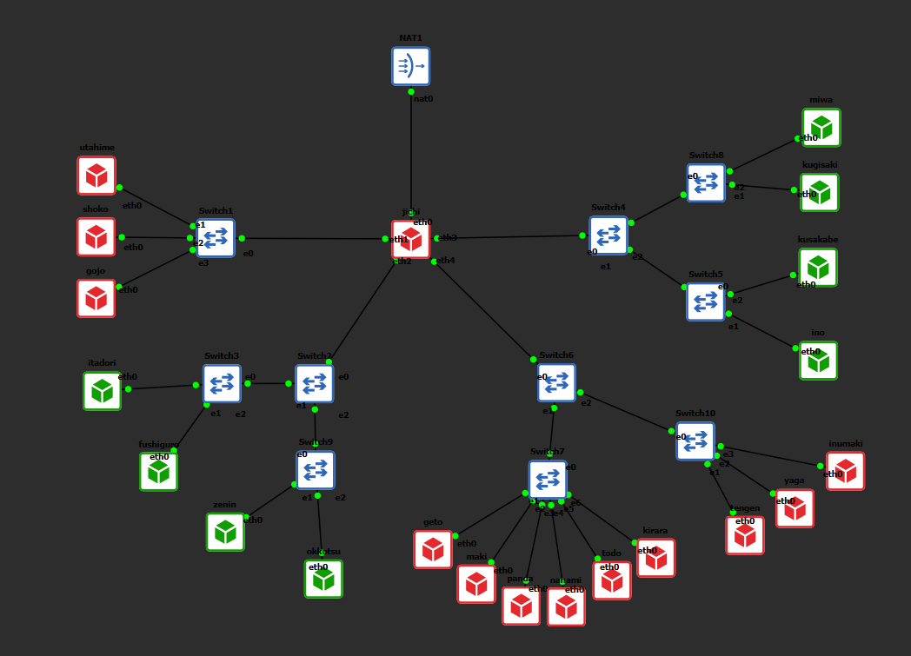
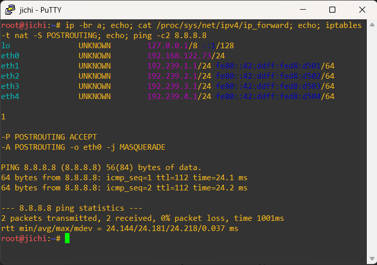
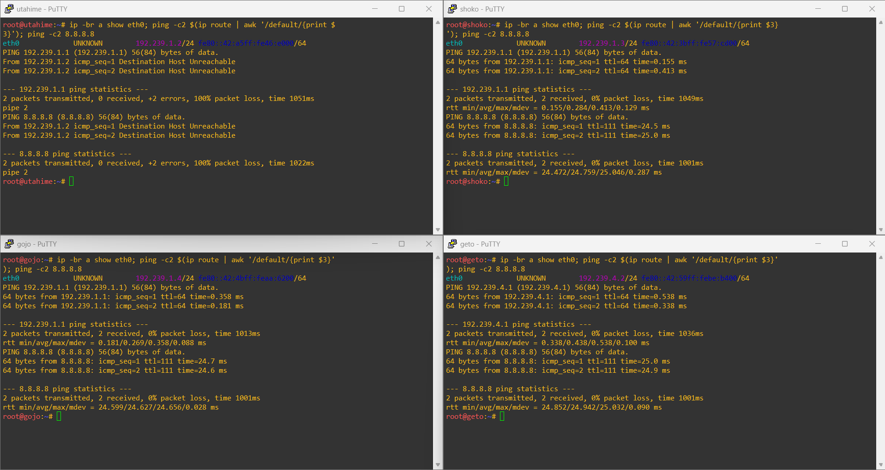

# Jarkom-Modul-3-2026-K-56

| No  | Nama                           | NRP        | Pengerjaan |
| --- | ------------------------------ | ---------- | ---------- |
| 1   | Sahira Bilqis Rivadito         | 5027251037 | No 1-10    |
| 2   | Muhammmad Ridwan               | 5027251113 | No 11-20   |

## LAPORAN RESMI MODUL 3

# SOAL 0 | TOPOLOGI



# SOAL 1 | Konektivitas Dasar 

Kelompok: K56 | Prefix IP: `192.239.x.x`

> Ketika Curtain menutup Shibuya, jalur komunikasi antar zona Jujutsu High terputus. Pulihkan konektivitas dasar dengan mengonfigurasi jichi: eth0 memperoleh WAN dari NAT, sedangkan eth1–eth4 menjadi gateway Network 1–4 sesuai tabel pemetaan. Aktifkan IPv4 forwarding dan source NAT, lalu tetapkan IP statis host infrastruktur sesuai tabel spesifikasi. Buktikan konektivitas setiap host ke gateway dan akses eksternal dari host yang relevan.

## 1. Tujuan

Memulihkan konektivitas dasar antar jaringan:

- jichi `eth0` memperoleh WAN dari NAT (DHCP)
- jichi `eth1`–`eth4` menjadi gateway Network 1–4 (/24)
- IPv4 forwarding dan source NAT (MASQUERADE) aktif
- Host infrastruktur memakai IP statis
- Membuktikan konektivitas tiap host ke gateway dan akses eksternal

## 2. Rancangan Alamat

| Network | Subnet | Gateway (jichi) | Interface jichi |
|---|---|---|---|
| NAT | 192.168.122.0/24 | 192.168.122.1 | eth0 (DHCP) |
| Network 1 (DMZ) | 192.239.1.0/24 | 192.239.1.1 | eth1 |
| Network 2 (Divisi A) | 192.239.2.0/24 | 192.239.2.1 | eth2 |
| Network 3 (Divisi B) | 192.239.3.0/24 | 192.239.3.1 | eth3 |
| Network 4 (Data Center) | 192.239.4.0/24 | 192.239.4.1 | eth4 |

### IP statis host infrastruktur

| Host | Peran | Network | IP | Gateway |
|---|---|---|---|---|
| utahime | DNS Master | 1 | 192.239.1.2 | 192.239.1.1 |
| shoko | DNS Slave | 1 | 192.239.1.3 | 192.239.1.1 |
| gojo | Reverse Proxy | 1 | 192.239.1.4 | 192.239.1.1 |
| geto | Load Balancer | 4 | 192.239.4.2 | 192.239.4.1 |
| maki | Worker frontend | 4 | 192.239.4.3 | 192.239.4.1 |
| panda | Worker frontend | 4 | 192.239.4.4 | 192.239.4.1 |
| nanami | Worker API utama | 4 | 192.239.4.5 | 192.239.4.1 |
| todo | Worker API utama | 4 | 192.239.4.6 | 192.239.4.1 |
| kirara | Worker API cadangan | 4 | 192.239.4.7 | 192.239.4.1 |
| inumaki | DB Slave | 4 | 192.239.4.8 | 192.239.4.1 |
| yaga | DB Master | 4 | 192.239.4.9 | 192.239.4.1 |
| tengen | DHCP Server | 4 | 192.239.4.10 | 192.239.4.1 |

Klien Network 2 dan 3 tidak diberi IP statis karena memperoleh alamat melalui DHCP relay (soal berikutnya).

## 3. Konfigurasi

### 3.1 jichi – `/etc/network/interfaces`

```
auto eth0
iface eth0 inet dhcp

auto eth1
iface eth1 inet static
    address 192.239.1.1
    netmask 255.255.255.0

auto eth2
iface eth2 inet static
    address 192.239.2.1
    netmask 255.255.255.0

auto eth3
iface eth3 inet static
    address 192.239.3.1
    netmask 255.255.255.0

auto eth4
iface eth4 inet static
    address 192.239.4.1
    netmask 255.255.255.0
```

### 3.2 jichi – IP forwarding dan source NAT

Bagian forwarding dan NAT pada `/root/setup-jichi.sh`:

```bash
#!/bin/bash
# IPv4 forwarding (langsung aktif + permanen)
echo 1 > /proc/sys/net/ipv4/ip_forward
echo "net.ipv4.ip_forward=1" > /etc/sysctl.d/99-forward.conf
sysctl --system >/dev/null

# Source NAT (idempotent)
apt update && apt install -y iptables
iptables -t nat -C POSTROUTING -o eth0 -j MASQUERADE 2>/dev/null || \
iptables -t nat -A POSTROUTING -o eth0 -j MASQUERADE
```

Catatan: `/etc/sysctl.conf` tidak ada di Debian trixie, sehingga forwarding permanen ditulis ke `/etc/sysctl.d/99-forward.conf`.

### 3.3 Host infrastruktur – contoh (utahime)

`/etc/network/interfaces`:

```
auto eth0
iface eth0 inet static
    address 192.239.1.2
    netmask 255.255.255.0
    gateway 192.239.1.1
```

Host lain memakai pola yang sama, hanya `address` dan `gateway` yang berbeda sesuai tabel pada bagian 2.

Untuk persiapan awal (unduh paket), DNS sementara:

```bash
echo "nameserver 192.168.122.1" > /etc/resolv.conf
```

## 4. Pembuktian

### 4.1 jichi

```bash
ip -br a
cat /proc/sys/net/ipv4/ip_forward
cat /etc/sysctl.d/99-forward.conf
iptables -t nat -S POSTROUTING
ip route
ping -c2 8.8.8.8
```

Hasil yang diharapkan:

- `eth0` memperoleh `192.168.122.x/24`; `eth1`–`eth4` bernilai `192.239.1.1` s.d. `192.239.4.1` dengan /24
- `ip_forward` bernilai `1`
- Terdapat aturan `-A POSTROUTING -o eth0 -j MASQUERADE`
- Ping ke `8.8.8.8` berhasil

> Screenshot: `[01-jichi.png]`

### 4.2 Setiap host infrastruktur

Dijalankan pada utahime, shoko, gojo, geto, maki, panda, nanami, todo, kirara, inumaki, yaga, dan tengen:

```bash
ip -br a show eth0
ping -c2 $(ip route | awk '/default/{print $3}')   # gateway
ping -c2 8.8.8.8                                    # akses eksternal
```

Hasil yang diharapkan: IP sesuai tabel, ping ke gateway dan ke `8.8.8.8` berhasil.

| Host | Screenshot |
|---|---|
| utahime, shoko, gojo, geto |  |
| maki, panda, nanami, todo |  |
| kirara, inumaki, yaga, tengen |  |

## 5. Kesimpulan

jichi berfungsi sebagai router: forwarding aktif, source NAT memberi akses internet, dan seluruh host infrastruktur terhubung ke gateway masing-masing serta dapat mengakses jaringan eksternal.

## 6. Pemulihan setelah restart

Aturan iptables tidak persisten. Setelah node restart, jalankan ulang script:

```bash
./setup-jichi.sh
```

# SOAL 2 | DHCP Server pada tengen

Kelompok: K56 | Prefix IP: `192.239.x.x`

> Tengen, penjaga pusat distribusi di Data Center, harus mengambil alih pengalokasian alamat bagi wilayah yang membutuhkan konfigurasi dinamis. Konfigurasikan isc-dhcp-server pada [PREFIX IP].4.10. Deklarasikan Network 4 ([PREFIX IP].4.0/24) sebagai subnet lokal tanpa pool dinamis, lalu siapkan scope DHCP untuk Network 2 ([PREFIX IP].2.0/24) dan Network 3 ([PREFIX IP].3.0/24). Validasi konfigurasi dan pastikan service aktif tanpa error “No subnet declaration”.

## 1. Tujuan

- Mengonfigurasi `isc-dhcp-server` pada tengen (`192.239.4.10`)
- Mendeklarasikan Network 4 (`192.239.4.0/24`) sebagai subnet lokal tanpa pool dinamis
- Menyiapkan scope DHCP untuk Network 2 (`192.239.2.0/24`) dan Network 3 (`192.239.3.0/24`)
- Memvalidasi konfigurasi dan memastikan service aktif tanpa error "No subnet declaration"

## 2. Rancangan

| Subnet | Peran | Pool dinamis |
|---|---|---|
| 192.239.4.0/24 | Subnet lokal tengen (Data Center) | Tidak ada |
| 192.239.2.0/24 | Divisi A (via relay jichi) | Ada |
| 192.239.3.0/24 | Divisi B (via relay jichi) | Ada |

Subnet 4.0 wajib dideklarasikan walau kosong. Tanpa deklarasi tersebut, dhcpd tidak menemukan subnet yang cocok dengan interface `eth0` (`192.239.4.10`) dan muncul error "No subnet declaration".

## 3. Konfigurasi

### 3.1 IP tengen – `/etc/network/interfaces`

```
auto eth0
iface eth0 inet static
    address 192.239.4.10
    netmask 255.255.255.0
    gateway 192.239.4.1
```

### 3.2 Script `/root/setup-tengen.sh`

Versi dasar untuk soal ini (range sementara; pool final diatur pada soal 4 dan seterusnya):

```bash
#!/bin/bash
echo "nameserver 192.168.122.1" > /etc/resolv.conf

# apt update boleh error (repo security), yang penting paket terpasang
apt update || true
apt install -y isc-dhcp-server

cat > /etc/default/isc-dhcp-server <<'EOF'
INTERFACESv4="eth0"
EOF

cat > /etc/dhcp/dhcpd.conf <<'EOF'
default-lease-time 600;
max-lease-time 7200;
authoritative;

# Network 4: subnet lokal, tanpa pool dinamis
subnet 192.239.4.0 netmask 255.255.255.0 {
}

# Network 2 (Divisi A)
subnet 192.239.2.0 netmask 255.255.255.0 {
    option routers 192.239.2.1;
    option subnet-mask 255.255.255.0;
    range 192.239.2.10 192.239.2.50;
}

# Network 3 (Divisi B)
subnet 192.239.3.0 netmask 255.255.255.0 {
    option routers 192.239.3.1;
    option subnet-mask 255.255.255.0;
    range 192.239.3.10 192.239.3.50;
}
EOF

dhcpd -t -cf /etc/dhcp/dhcpd.conf && service isc-dhcp-server restart
service isc-dhcp-server status
```

Jalankan:

```bash
chmod +x /root/setup-tengen.sh
/root/setup-tengen.sh
```

## 4. Validasi dan Pembuktian

Dijalankan pada tengen:

```bash
ip -br a show eth0
dhcpd -t -cf /etc/dhcp/dhcpd.conf; echo "exit code: $?"
service isc-dhcp-server status
ps aux | grep [d]hcpd
cat /etc/dhcp/dhcpd.conf
```

Hasil yang diharapkan:

- `eth0` bernilai `192.239.4.10/24`
- `dhcpd -t` tanpa error, `exit code: 0`
- `dhcpd is running`
- Tidak ada pesan "No subnet declaration"
- `dhcpd.conf` memuat tiga deklarasi subnet (4.0 kosong, 2.0, 3.0)

> Screenshot:
> - `[01-tengen-ip.png]` – IP tengen
> - `[02-dhcpd-test.png]` – `dhcpd -t` exit code 0
> - `[03-dhcpd-status.png]` – service running
> - `[04-dhcpd-conf.png]` – isi `dhcpd.conf`

## 5. Kesimpulan

isc-dhcp-server pada tengen berjalan dengan deklarasi subnet Network 4 (tanpa pool) serta scope untuk Network 2 dan Network 3. Konfigurasi lolos validasi dan service aktif tanpa error "No subnet declaration". Pembuktian pemberian lease ke klien melalui relay dilakukan pada soal 3.

## 6. Pemulihan setelah restart

```bash
service isc-dhcp-server restart
# jika dhcpd.conf atau paket hilang:
/root/setup-tengen.sh
```

# SOAL 3 | DHCP Relay pada jichi

Kelompok: K56 | Prefix IP: `192.239.x.x`

> Permintaan alamat dari Divisi A dan Divisi B tidak dapat menyeberangi subnet secara langsung. Konfigurasikan jichi sebagai DHCP Relay menuju tengen ([PREFIX IP].4.10), menggunakan eth2 untuk Network 2 dan eth3 untuk Network 3. Buktikan bahwa client dari kedua subnet berhasil memperoleh lease melalui relay.

## 1. Tujuan

Permintaan alamat dari Divisi A dan Divisi B tidak dapat menyeberangi subnet secara langsung (broadcast tidak dilewatkan router). jichi dikonfigurasi sebagai DHCP Relay menuju tengen (`192.239.4.10`):

- `eth2` untuk Network 2
- `eth3` untuk Network 3
- Membuktikan klien kedua subnet memperoleh lease melalui relay

## 2. Alur kerja relay

```
Klien (N2/N3) --broadcast DISCOVER--> jichi (eth2/eth3)
jichi --unicast, giaddr = IP interface penerima--> tengen (192.239.4.10)
tengen --OFFER/ACK ke giaddr--> jichi --> Klien
```

| Klien | Interface jichi penerima | giaddr |
|---|---|---|
| Network 2 | eth2 | 192.239.2.1 |
| Network 3 | eth3 | 192.239.3.1 |

## 3. Konfigurasi

### 3.1 `/etc/default/isc-dhcp-relay` pada jichi

```
SERVERS="192.239.4.10"
INTERFACES=""
OPTIONS="-id eth2 -id eth3 -iu eth4"
```

- `-id eth2 -id eth3`: interface sisi klien (downstream)
- `-iu eth4`: interface sisi server (upstream) menuju Data Center

### 3.2 Bagian relay pada `/root/setup-jichi.sh`

```bash
apt update && apt install -y isc-dhcp-relay

cat > /etc/default/isc-dhcp-relay <<'EOF'
SERVERS="192.239.4.10"
INTERFACES=""
OPTIONS="-id eth2 -id eth3 -iu eth4"
EOF

service isc-dhcp-relay restart
service isc-dhcp-relay status
```

### 3.3 Klien menggunakan DHCP

`/etc/network/interfaces` pada itadori, fushiguro, zenin, okkotsu, ino, kusakabe, miwa, dan kugisaki:

```
auto eth0
iface eth0 inet dhcp
```

## 4. Pembuktian

### 4.1 jichi

```bash
cat /etc/default/isc-dhcp-relay
ps aux | grep [d]hcrelay
```

Hasil yang diharapkan: tujuan `192.239.4.10`, proses `dhcrelay -q -id eth2 -id eth3 -iu eth4 192.239.4.10`.

> Screenshot: `[01-jichi-relay.png]`

### 4.2 Klien Network 2 (itadori)

```bash
ifdown eth0; ifup eth0
ip -br a show eth0
ip route | grep default
```

Hasil: `lease of 192.239.2.x obtained from 192.239.4.10`, IP `192.239.2.x/24`, default route `192.239.2.1`.

> Screenshot: `[02-itadori-lease.png]`

### 4.3 Klien Network 3 (miwa)

Perintah sama seperti di atas.

Hasil: `lease of 192.239.3.x obtained from 192.239.4.10`, IP `192.239.3.x/24`, default route `192.239.3.1`.

> Screenshot: `[03-miwa-lease.png]`

### 4.4 Sisi server (tengen)

```bash
grep -E "^lease|hardware ethernet" /var/lib/dhcp/dhcpd.leases | tail -n 20
```

Hasil: terdapat lease untuk `192.239.2.x` dan `192.239.3.x` beserta MAC klien, membuktikan permintaan dari kedua subnet sampai ke tengen.

> Screenshot: `[04-tengen-leases.png]`

### 4.5 Bukti tambahan (opsional): tangkap paket

Pada tengen:

```bash
tcpdump -ni eth0 port 67 or port 68
```

Discover/Request tampak dari `192.239.4.1` (jichi eth4) ke `192.239.4.10`, sedangkan Offer/ACK dikirim tengen ke `192.239.2.1` atau `192.239.3.1` (giaddr), sehingga membuktikan paket diteruskan oleh relay.

> Screenshot: `[05-tcpdump.png]`

## 5. Kesimpulan

jichi berfungsi sebagai DHCP Relay: eth2 dan eth3 menerima broadcast dari Network 2 dan 3, meneruskannya ke tengen (`192.239.4.10`) lewat eth4, dan membawa balasan kembali ke klien. Klien kedua subnet berhasil memperoleh lease dari tengen.

## 6. Pemulihan setelah restart

```bash
./setup-jichi.sh
```

Script ini menulis ulang konfigurasi relay yang benar dan menjalankan service.


# SOAL 4 | Dua Pool DHCP pada Network 2

Kelompok: K56 | Prefix IP: `192.239.x.x`

> Agar tim Dev dan Support di Divisi A menerima jatah alamat yang berbeda, atur dua pool DHCP pada Network 2. Tetapkan Pool 1 ([PREFIX IP].2.10–[PREFIX IP].2.35) untuk itadori dan fushiguro, serta Pool 2 ([PREFIX IP].2.70–[PREFIX IP].2.95) untuk zenin dan okkotsu. Rentang [PREFIX IP].2.36–[PREFIX IP].2.69 tidak boleh dialokasikan. Karena seluruh client berada pada subnet yang sama, gunakan DHCP class berdasarkan MAC Address atau Client ID untuk memisahkan kedua kelompok.

## 1. Tujuan

Tim Dev dan Support di Divisi A menerima jatah alamat yang berbeda. Dua pool dibuat pada Network 2:

| Pool | Rentang | Klien |
|---|---|---|
| Pool 1 | 192.239.2.10 – 192.239.2.35 | itadori, fushiguro |
| Pool 2 | 192.239.2.70 – 192.239.2.95 | zenin, okkotsu |

Rentang `192.239.2.36 – 192.239.2.69` tidak boleh dialokasikan. Karena seluruh klien berada pada subnet yang sama, pemisahan dilakukan dengan DHCP class berdasarkan MAC Address.

## 2. Rancangan

- Setiap kelompok klien didefinisikan sebagai `class` yang dicocokkan dengan MAC (`substring(hardware, 1, 6)`).
- Setiap `pool` dibatasi dengan `allow members of "<class>"`, sehingga hanya anggota class tersebut yang dilayani dari range pool itu.
- Rentang `.36–.69` tidak dimasukkan ke range manapun, sehingga tidak pernah dialokasikan.

### Pemetaan MAC

MAC diambil dari tiap klien dengan `ip link show eth0 | grep ether`.

| Klien | MAC | Class |
|---|---|---|
| itadori | 02:42:7d:a7:cb:00 | pool1 |
| fushiguro | 02:42:d6:51:ef:00 | pool1 |
| zenin | f2:dd:ec:51:c9:cb | pool2 |
| okkotsu | 02:42:54:9b:57:00 | pool2 |

Catatan: MAC zenin sebelumnya `02:42:30:6b:50:00` dan berubah setelah node di-restart/dibuat ulang (lihat bagian 4).

## 3. Konfigurasi

Blok Network 2 pada heredoc `dhcpd.conf` di `/root/setup-tengen.sh`:

```
# Network 2 (Divisi A)
class "pool1" {
    match if (substring(hardware, 1, 6) = 02:42:7d:a7:cb:00)
          or (substring(hardware, 1, 6) = 02:42:d6:51:ef:00);
}

class "pool2" {
    match if (substring(hardware, 1, 6) = f2:dd:ec:51:c9:cb)
          or (substring(hardware, 1, 6) = 02:42:54:9b:57:00);
}

subnet 192.239.2.0 netmask 255.255.255.0 {
    option routers 192.239.2.1;
    option subnet-mask 255.255.255.0;

    pool {
        allow members of "pool1";
        range 192.239.2.10 192.239.2.35;
    }

    pool {
        allow members of "pool2";
        range 192.239.2.70 192.239.2.95;
    }
}
```

Terapkan dan validasi:

```bash
./setup-tengen.sh
dhcpd -t -cf /etc/dhcp/dhcpd.conf; echo "exit code: $?"
```

Karena klien masih memegang lease dari range lama, lease dikosongkan agar klien meminta ulang:

```bash
service isc-dhcp-server stop
: > /var/lib/dhcp/dhcpd.leases
service isc-dhcp-server start
```

Lalu pada tiap klien Network 2:

```bash
ifdown eth0; ifup eth0
```

## 4. Pembuktian

### 4.1 Klien Network 2

Pada itadori, fushiguro, zenin, dan okkotsu:

```bash
ip link show eth0 | grep ether
ifdown eth0; ifup eth0
ip -4 addr show eth0
```

| Klien | IP yang diharapkan |
|---|---|
| itadori, fushiguro | 192.239.2.10 – .35 |
| zenin, okkotsu | 192.239.2.70 – .95 |

Hasil terverifikasi sejauh ini:

- itadori: `192.239.2.11` (Pool 1)
- fushiguro: `192.239.2.14` (Pool 1)
- okkotsu: `192.239.2.70` (Pool 2)
- zenin: diverifikasi ulang setelah MAC diperbarui

> Screenshot: `[01-itadori.png]`, `[02-fushiguro.png]`, `[03-zenin.png]`, `[04-okkotsu.png]`

### 4.2 Sisi server (tengen)

```bash
cat /etc/dhcp/dhcpd.conf
dhcpd -t -cf /etc/dhcp/dhcpd.conf; echo "exit code: $?"
grep -E "^lease|hardware ethernet|^  binding state" /var/lib/dhcp/dhcpd.leases
```

Hasil yang diharapkan: konfigurasi memuat class dan dua pool, exit code `0`, dan tidak ada lease pada `192.239.2.36 – .69`.

> Screenshot: `[05-dhcpd-conf.png]`, `[06-dhcpd-test.png]`, `[07-leases.png]`

## 5. Kesimpulan

Network 2 dilayani dua pool terpisah berdasarkan class MAC: itadori dan fushiguro memperoleh alamat dari Pool 1, zenin dan okkotsu dari Pool 2, sedangkan rentang `.36–.69` tidak pernah dialokasikan.

## 6. Pemulihan setelah restart

Jika MAC klien berubah, cocokkan ulang dengan class di `dhcpd.conf` tengen:

```bash
ip link show eth0 | grep ether                       # di klien
grep -n "substring(hardware" /etc/dhcp/dhcpd.conf    # di tengen
```

Perbarui MAC yang berbeda pada `./setup-tengen.sh`, lalu jalankan ulang script.


# SOAL 5 | Short Lease dan Long Lease pada Network 3

Kelompok: K56 | Prefix IP: `192.239.x.x`

> Setiap tim lapangan memiliki durasi operasi yang berbeda. Pada Network 3, berikan short lease 30 menit (1800 detik) kepada ino dan kusakabe, serta long lease 12 jam (43200 detik) kepada miwa. Gunakan pool short lease [PREFIX IP].3.10–[PREFIX IP].3.89 dan pool long lease [PREFIX IP].3.100–[PREFIX IP].3.199. Sesuaikan default-lease-time dan max-lease-time untuk setiap kelas client. Berikan pula DHCP options berupa DNS [PREFIX IP].1.2 dan [PREFIX IP].1.3, serta domain-search <xxxx>.com.

## 1. Tujuan

Setiap tim lapangan memiliki durasi operasi yang berbeda. Pada Network 3:

| Kelas | Klien | Pool | Lease time |
|---|---|---|---|
| short | ino, kusakabe | 192.239.3.10 – 192.239.3.89 | 30 menit (1800 detik) |
| long | miwa | 192.239.3.100 – 192.239.3.199 | 12 jam (43200 detik) |

Tambahan: `default-lease-time` dan `max-lease-time` disesuaikan untuk setiap kelas klien, serta DHCP options berikut:

- DNS: `192.239.1.2` dan `192.239.1.3`
- Domain-search: `k56.com`

## 2. Rancangan

- Dua `class` berdasarkan MAC (`short` dan `long`), masing-masing memuat `default-lease-time` dan `max-lease-time` sendiri.
- Dua `pool`, masing-masing dibatasi dengan `allow members of`.
- `max-lease-time` disamakan dengan `default-lease-time` agar klien tidak dapat meminta lease lebih lama dari ketentuan.
- Option DNS dan domain-search diletakkan pada level subnet sehingga berlaku untuk seluruh klien Network 3.
- Rentang `.90–.99` dan `.200` ke atas tidak masuk pool manapun.

### Pemetaan MAC

| Klien | MAC | Class |
|---|---|---|
| ino / kusakabe | 02:42:a6:c1:7d:00 | short |
| kusakabe / ino | 02:42:55:d0:dc:00 | short |
| miwa | 02:42:14:04:b7:00 | long |

Catatan: dua MAC pada class short dimiliki ino dan kusakabe; urutan di antara keduanya tidak berpengaruh karena keduanya satu class. kugisaki berada di luar kedua class (fixed address, soal 6).

## 3. Konfigurasi

Blok Network 3 pada heredoc `dhcpd.conf` di `/root/setup-tengen.sh`:

```
# Network 3 (Divisi B)
class "short" {
    match if (substring(hardware, 1, 6) = 02:42:a6:c1:7d:00)
          or (substring(hardware, 1, 6) = 02:42:55:d0:dc:00);
    default-lease-time 1800;
    max-lease-time 1800;
}

class "long" {
    match if (substring(hardware, 1, 6) = 02:42:14:04:b7:00);
    default-lease-time 43200;
    max-lease-time 43200;
}

subnet 192.239.3.0 netmask 255.255.255.0 {
    option routers 192.239.3.1;
    option subnet-mask 255.255.255.0;
    option domain-name-servers 192.239.1.2, 192.239.1.3;
    option domain-search "k56.com";

    pool {
        allow members of "short";
        range 192.239.3.10 192.239.3.89;
    }

    pool {
        allow members of "long";
        range 192.239.3.100 192.239.3.199;
    }
}
```

Terapkan dan validasi:

```bash
grep -n "MAC:" /root/setup-tengen.sh      # harus kosong
/root/setup-tengen.sh
dhcpd -t -cf /etc/dhcp/dhcpd.conf; echo "exit code: $?"
service isc-dhcp-server stop; : > /var/lib/dhcp/dhcpd.leases; service isc-dhcp-server start
```

### Kendala yang ditemui

| Kendala | Penyebab | Penyelesaian |
|---|---|---|
| `dhcpd -t` gagal pada class short | Prefix `MAC:` dari placeholder masih menempel pada nilai MAC | `sed -i 's/MAC://g' /root/setup-tengen.sh` |

## 4. Pembuktian

### 4.1 Klien Network 3

Pada ino, kusakabe, dan miwa:

```bash
ifdown eth0; ifup eth0
ip -br a show eth0
cat /etc/resolv.conf
```

| Klien | IP yang diharapkan | Lease time pada output `ifup` |
|---|---|---|
| ino, kusakabe | 192.239.3.10 – .89 | 1800 |
| miwa | 192.239.3.100 – .199 | 43200 |

Hasil terverifikasi sejauh ini:

- ino/kusakabe: `192.239.3.10` dan `192.239.3.11` (class short)
- miwa: `192.239.3.100` (class long)

`/etc/resolv.conf` berisi `nameserver 192.239.1.2` dan `nameserver 192.239.1.3`.

> Screenshot: `[01-ino.png]`, `[02-kusakabe.png]`, `[03-miwa.png]`

### 4.2 Bukti domain-search

Udhcpc pada klien Alpine hanya menuliskan DNS (option 6) ke `resolv.conf` dan tidak menuliskan domain-search (option 119), sehingga baris `search` tidak selalu tampil. Pembuktian dilakukan dari paket DHCP ACK di tengen:

```bash
tcpdump -vni eth0 port 67
```

Lalu renew satu klien; pada paket ACK terlihat option Domain-Name-Server (6) dan Domain-Search (119) berisi `k56.com`.

> Screenshot: `[04-tcpdump-option.png]`

### 4.3 Sisi server (tengen)

```bash
cat /etc/dhcp/dhcpd.conf
dhcpd -t -cf /etc/dhcp/dhcpd.conf; echo "exit code: $?"
grep -E "^lease|hardware ethernet|ends" /var/lib/dhcp/dhcpd.leases
```

Hasil yang diharapkan: exit code `0`, tidak ada lease pada `192.239.3.90 – .99`, dan lease miwa berdurasi jauh lebih panjang daripada ino dan kusakabe.

> Screenshot: `[05-dhcpd-conf.png]`, `[06-leases.png]`

## 5. Kesimpulan

Network 3 dilayani dua kelas lease: ino dan kusakabe memperoleh alamat `.3.10–.3.89` dengan lease 1800 detik, sedangkan miwa memperoleh alamat `.3.100–.3.199` dengan lease 43200 detik. Seluruh klien Network 3 menerima DNS `192.239.1.2` dan `192.239.1.3` serta domain-search `k56.com`.

## 6. Pemulihan setelah restart

Jika MAC klien berubah, cocokkan ulang dengan class di tengen:

```bash
grep -n "substring(hardware" /etc/dhcp/dhcpd.conf
```

Perbarui MAC yang berbeda pada `./setup-tengen.sh`, jalankan ulang script, lalu reset lease.


# Soal 6 – Fixed Address untuk kugisaki

Kelompok: K56 | Prefix IP: `192.239.x.x`

> Kugisaki ditetapkan sebagai personel VIP yang harus mempertahankan alamat yang sama setiap kali terhubung. Buat DHCP static lease berdasarkan MAC Address client tersebut dengan fixed address [PREFIX IP].3.99. Pastikan alamat ini berada di luar seluruh pool dinamis, validasi konfigurasi server, lalu renew lease pada client. Buktikan bahwa alamat yang diterima sesuai dengan reservasi.

## 1. Tujuan

kugisaki ditetapkan sebagai personel VIP yang harus mempertahankan alamat yang sama setiap kali terhubung:

- DHCP static lease berdasarkan MAC Address kugisaki
- Fixed address `192.239.3.99`
- Alamat berada di luar seluruh pool dinamis
- Validasi konfigurasi server, renew lease pada klien, dan buktikan alamat sesuai reservasi

## 2. Rancangan

`192.239.3.99` berada di luar kedua pool dinamis Network 3, sehingga tidak berpotensi bentrok dengan alokasi dinamis:

| Pool | Rentang |
|---|---|
| short | 192.239.3.10 – 192.239.3.89 |
| (fixed kugisaki) | **192.239.3.99** |
| long | 192.239.3.100 – 192.239.3.199 |

Reservasi dibuat dengan blok `host` berdasarkan MAC. Option router, DNS, dan domain-search tetap diambil dari blok subnet Network 3. Lease time kugisaki memakai default global (600 detik) karena soal tidak meminta nilai khusus.

### MAC kugisaki

Diambil pada kugisaki:

```bash
ip link show eth0 | grep ether
```

Hasil: `02:42:5c:a9:44:00`

## 3. Konfigurasi

Blok `host` pada heredoc `dhcpd.conf` di `/root/setup-tengen.sh`, ditempatkan setelah blok subnet Network 3:

```
host kugisaki {
    hardware ethernet 02:42:5c:a9:44:00;
    fixed-address 192.239.3.99;
}
```

Terapkan dan validasi pada tengen:

```bash
/root/setup-tengen.sh
dhcpd -t -cf /etc/dhcp/dhcpd.conf; echo "exit code: $?"
service isc-dhcp-server restart
service isc-dhcp-server status
```

Renew lease pada kugisaki:

```bash
ifdown eth0; ifup eth0
ip -br a show eth0
ip route | grep default
```

### Kendala yang ditemui

| Kendala | Penyebab | Penyelesaian |
|---|---|---|
| `ifdown: command not found` saat dijalankan di tengen | Perintah renew dijalankan di node server, bukan di klien | Jalankan `ifdown/ifup` pada kugisaki |
| `dhcpd.leases` belum memuat `192.239.3.99` setelah validasi | Konfigurasi baru belum dipakai service dan kugisaki belum meminta ulang | Restart service, lalu renew pada kugisaki |

## 4. Pembuktian

### 4.1 Sisi server (tengen)

```bash
grep -B1 -A4 "host kugisaki" /etc/dhcp/dhcpd.conf
dhcpd -t -cf /etc/dhcp/dhcpd.conf; echo "exit code: $?"
grep -A8 "192.239.3.99" /var/lib/dhcp/dhcpd.leases
```

Hasil: blok `host kugisaki` memuat MAC `02:42:5c:a9:44:00` dan fixed-address `192.239.3.99`, `dhcpd -t` exit code `0`, dan lease `192.239.3.99` tercatat dengan MAC kugisaki.

> Screenshot: `[01-host-block.png]`, `[02-dhcpd-test.png]`, `[03-leases.png]`

### 4.2 Klien (kugisaki)

Output renew:

```
udhcpc: broadcasting select for 192.239.3.99, server 192.239.4.10
udhcpc: lease of 192.239.3.99 obtained from 192.239.4.10, lease time 600
eth0   UNKNOWN   192.239.3.99/24 fe80::42:5cff:fea9:4400/64
default via 192.239.3.1 dev eth0
```

Alamat yang diterima (`192.239.3.99`) sesuai dengan reservasi, dengan gateway `192.239.3.1`.

Untuk membuktikan alamat tetap, renew diulang:

```bash
ifdown eth0; ifup eth0; ip -br a show eth0
```

Hasil: tetap `192.239.3.99/24`.

> Screenshot: `[04-kugisaki-lease.png]`, `[05-kugisaki-renew-ulang.png]`

## 5. Kesimpulan

kugisaki memperoleh alamat tetap `192.239.3.99` dari tengen (`192.239.4.10`) berdasarkan MAC `02:42:5c:a9:44:00`. Alamat ini berada di luar pool short dan long, validasi konfigurasi lolos, dan alamat tetap sama setiap lease diperbarui.

## 6. Pemulihan setelah restart

Jika MAC kugisaki berubah, perbarui blok `host` pada `/root/setup-tengen.sh`:

```bash
ip link show eth0 | grep ether       # di kugisaki
grep -A3 "host kugisaki" /etc/dhcp/dhcpd.conf   # di tengen
```

Lalu jalankan ulang `/root/setup-tengen.sh` dan renew pada kugisaki.
