# Jarkom-Modul-3-2026-K-56

| No  | Nama                           | NRP        | Pengerjaan |
| --- | ------------------------------ | ---------- | ---------- |
| 1   | Muhammmad Ridwan               | 5027251113 | No 1-10   |
| 2   | Sahira Bilqis Rivadito         | 5027251037 | No 11-20    |

## LAPORAN RESMI MODUL 3

# SOAL 0 | TOPOLOGI


# SOAL 1 | Konektivitas Dasar 

Kelompok: K56 | Prefix IP: `192.239.x.x`

> Ketika Curtain menutup Shibuya, jalur komunikasi antar zona Jujutsu High terputus. Pulihkan konektivitas dasar dengan mengonfigurasi jichi: eth0 memperoleh WAN dari NAT, sedangkan eth1–eth4 menjadi gateway Network 1–4 sesuai tabel pemetaan. Aktifkan IPv4 forwarding dan source NAT, lalu tetapkan IP statis host infrastruktur sesuai tabel spesifikasi. Buktikan konektivitas setiap host ke gateway dan akses eksternal dari host yang relevan.

## 1. Tujuan

Memulihkan konektivitas dasar antar jaringan:

- jichi `eth0` memperoleh WAN dari NAT (DHCP)
- jichi `eth1`–`eth4` menjadi gateway Network 1–4 (/24)
- IPv4 forwarding dan source NAT (MASQUERADE) aktif
- Host infrastruktur memakai IP statis
- Membuktikan konektivitas tiap host ke gateway dan akses eksternal

## 2. Rancangan Alamat

| Network | Subnet | Gateway (jichi) | Interface jichi |
|---|---|---|---|
| NAT | 192.168.122.0/24 | 192.168.122.1 | eth0 (DHCP) |
| Network 1 (DMZ) | 192.239.1.0/24 | 192.239.1.1 | eth1 |
| Network 2 (Divisi A) | 192.239.2.0/24 | 192.239.2.1 | eth2 |
| Network 3 (Divisi B) | 192.239.3.0/24 | 192.239.3.1 | eth3 |
| Network 4 (Data Center) | 192.239.4.0/24 | 192.239.4.1 | eth4 |

### IP statis host infrastruktur

| Host | Peran | Network | IP | Gateway |
|---|---|---|---|---|
| utahime | DNS Master | 1 | 192.239.1.2 | 192.239.1.1 |
| shoko | DNS Slave | 1 | 192.239.1.3 | 192.239.1.1 |
| gojo | Reverse Proxy | 1 | 192.239.1.4 | 192.239.1.1 |
| geto | Load Balancer | 4 | 192.239.4.2 | 192.239.4.1 |
| maki | Worker frontend | 4 | 192.239.4.3 | 192.239.4.1 |
| panda | Worker frontend | 4 | 192.239.4.4 | 192.239.4.1 |
| nanami | Worker API utama | 4 | 192.239.4.5 | 192.239.4.1 |
| todo | Worker API utama | 4 | 192.239.4.6 | 192.239.4.1 |
| kirara | Worker API cadangan | 4 | 192.239.4.7 | 192.239.4.1 |
| inumaki | DB Slave | 4 | 192.239.4.8 | 192.239.4.1 |
| yaga | DB Master | 4 | 192.239.4.9 | 192.239.4.1 |
| tengen | DHCP Server | 4 | 192.239.4.10 | 192.239.4.1 |

Klien Network 2 dan 3 tidak diberi IP statis karena memperoleh alamat melalui DHCP relay (soal berikutnya).

## 3. Konfigurasi

### 3.1 jichi – `/etc/network/interfaces`

```
auto eth0
iface eth0 inet dhcp

auto eth1
iface eth1 inet static
    address 192.239.1.1
    netmask 255.255.255.0

auto eth2
iface eth2 inet static
    address 192.239.2.1
    netmask 255.255.255.0

auto eth3
iface eth3 inet static
    address 192.239.3.1
    netmask 255.255.255.0

auto eth4
iface eth4 inet static
    address 192.239.4.1
    netmask 255.255.255.0
```

### 3.2 jichi – IP forwarding dan source NAT

Bagian forwarding dan NAT pada `/root/setup-jichi.sh`:

```bash
#!/bin/bash
# IPv4 forwarding (langsung aktif + permanen)
echo 1 > /proc/sys/net/ipv4/ip_forward
echo "net.ipv4.ip_forward=1" > /etc/sysctl.d/99-forward.conf
sysctl --system >/dev/null

# Source NAT (idempotent)
apt update && apt install -y iptables
iptables -t nat -C POSTROUTING -o eth0 -j MASQUERADE 2>/dev/null || \
iptables -t nat -A POSTROUTING -o eth0 -j MASQUERADE
```

Catatan: `/etc/sysctl.conf` tidak ada di Debian trixie, sehingga forwarding permanen ditulis ke `/etc/sysctl.d/99-forward.conf`.

### 3.3 Host infrastruktur – contoh (utahime)

`/etc/network/interfaces`:

```
auto eth0
iface eth0 inet static
    address 192.239.1.2
    netmask 255.255.255.0
    gateway 192.239.1.1
```

Host lain memakai pola yang sama, hanya `address` dan `gateway` yang berbeda sesuai tabel pada bagian 2.

Untuk persiapan awal (unduh paket), DNS sementara:

```bash
echo "nameserver 192.168.122.1" > /etc/resolv.conf
```

## 4. Pembuktian

### 4.1 jichi

```bash
ip -br a
cat /proc/sys/net/ipv4/ip_forward
cat /etc/sysctl.d/99-forward.conf
iptables -t nat -S POSTROUTING
ip route
ping -c2 8.8.8.8
```

Hasil yang diharapkan:

- `eth0` memperoleh `192.168.122.x/24`; `eth1`–`eth4` bernilai `192.239.1.1` s.d. `192.239.4.1` dengan /24
- `ip_forward` bernilai `1`
- Terdapat aturan `-A POSTROUTING -o eth0 -j MASQUERADE`
- Ping ke `8.8.8.8` berhasil

Screenshot:


### 4.2 Setiap host infrastruktur

Dijalankan pada utahime, shoko, gojo, geto, maki, panda, nanami, todo, kirara, inumaki, yaga, dan tengen:

```bash
ip -br a show eth0
ping -c2 $(ip route | awk '/default/{print $3}')   # gateway
ping -c2 8.8.8.8                                    # akses eksternal
```

Hasil yang diharapkan: IP sesuai tabel, ping ke gateway dan ke `8.8.8.8` berhasil.

| Host | Screenshot |
|---|---|
| utahime, shoko, gojo, geto |  |
| maki, panda, nanami, todo | 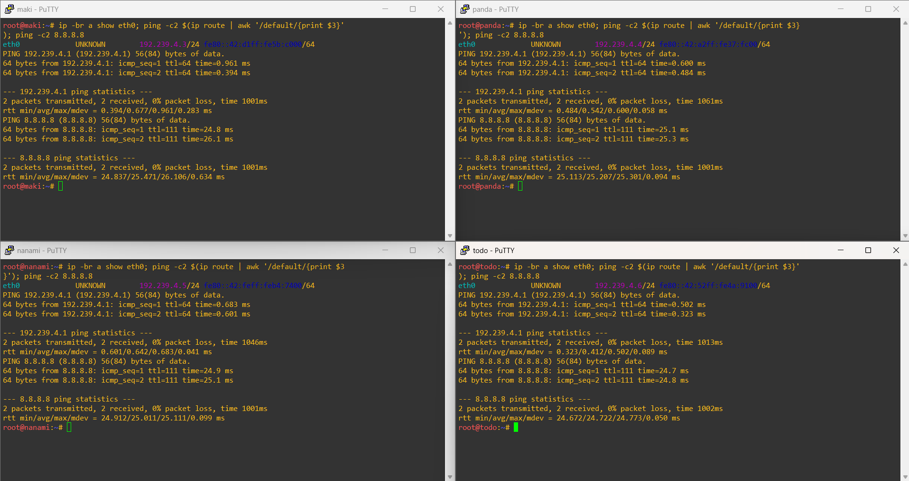 |
| kirara, inumaki, yaga, tengen | 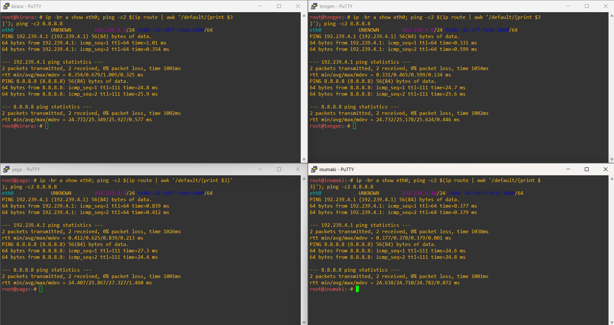 |

## 5. Kesimpulan

jichi berfungsi sebagai router: forwarding aktif, source NAT memberi akses internet, dan seluruh host infrastruktur terhubung ke gateway masing-masing serta dapat mengakses jaringan eksternal.

## 6. Pemulihan setelah restart

Aturan iptables tidak persisten. Setelah node restart, jalankan ulang script:

```bash
./setup-jichi.sh
```

# SOAL 2 | DHCP Server pada tengen

Kelompok: K56 | Prefix IP: `192.239.x.x`

> Tengen, penjaga pusat distribusi di Data Center, harus mengambil alih pengalokasian alamat bagi wilayah yang membutuhkan konfigurasi dinamis. Konfigurasikan isc-dhcp-server pada [PREFIX IP].4.10. Deklarasikan Network 4 ([PREFIX IP].4.0/24) sebagai subnet lokal tanpa pool dinamis, lalu siapkan scope DHCP untuk Network 2 ([PREFIX IP].2.0/24) dan Network 3 ([PREFIX IP].3.0/24). Validasi konfigurasi dan pastikan service aktif tanpa error “No subnet declaration”.

## 1. Tujuan

- Mengonfigurasi `isc-dhcp-server` pada tengen (`192.239.4.10`)
- Mendeklarasikan Network 4 (`192.239.4.0/24`) sebagai subnet lokal tanpa pool dinamis
- Menyiapkan scope DHCP untuk Network 2 (`192.239.2.0/24`) dan Network 3 (`192.239.3.0/24`)
- Memvalidasi konfigurasi dan memastikan service aktif tanpa error "No subnet declaration"

## 2. Rancangan

| Subnet | Peran | Pool dinamis |
|---|---|---|
| 192.239.4.0/24 | Subnet lokal tengen (Data Center) | Tidak ada |
| 192.239.2.0/24 | Divisi A (via relay jichi) | Ada |
| 192.239.3.0/24 | Divisi B (via relay jichi) | Ada |

Subnet 4.0 wajib dideklarasikan walau kosong. Tanpa deklarasi tersebut, dhcpd tidak menemukan subnet yang cocok dengan interface `eth0` (`192.239.4.10`) dan muncul error "No subnet declaration".

## 3. Konfigurasi

### 3.1 IP tengen – `/etc/network/interfaces`

```
auto eth0
iface eth0 inet static
    address 192.239.4.10
    netmask 255.255.255.0
    gateway 192.239.4.1
```

### 3.2 Script `/root/setup-tengen.sh`

Versi dasar untuk soal ini (range sementara; pool final diatur pada soal 4 dan seterusnya):

```bash
#!/bin/bash
echo "nameserver 192.168.122.1" > /etc/resolv.conf

# apt update boleh error (repo security), yang penting paket terpasang
apt update || true
apt install -y isc-dhcp-server

cat > /etc/default/isc-dhcp-server <<'EOF'
INTERFACESv4="eth0"
EOF

cat > /etc/dhcp/dhcpd.conf <<'EOF'
default-lease-time 600;
max-lease-time 7200;
authoritative;

# Network 4: subnet lokal, tanpa pool dinamis
subnet 192.239.4.0 netmask 255.255.255.0 {
}

# Network 2 (Divisi A)
subnet 192.239.2.0 netmask 255.255.255.0 {
    option routers 192.239.2.1;
    option subnet-mask 255.255.255.0;
    range 192.239.2.10 192.239.2.50;
}

# Network 3 (Divisi B)
subnet 192.239.3.0 netmask 255.255.255.0 {
    option routers 192.239.3.1;
    option subnet-mask 255.255.255.0;
    range 192.239.3.10 192.239.3.50;
}
EOF

dhcpd -t -cf /etc/dhcp/dhcpd.conf && service isc-dhcp-server restart
service isc-dhcp-server status
```

Jalankan:

```bash
chmod +x /root/setup-tengen.sh
/root/setup-tengen.sh
```

## 4. Validasi dan Pembuktian

Dijalankan pada tengen:

```bash
ip -br a show eth0
dhcpd -t -cf /etc/dhcp/dhcpd.conf; echo "exit code: $?"
service isc-dhcp-server status
ps aux | grep [d]hcpd
cat /etc/dhcp/dhcpd.conf
```

Hasil yang diharapkan:

- `eth0` bernilai `192.239.4.10/24`
- `dhcpd -t` tanpa error, `exit code: 0`
- `dhcpd is running`
- Tidak ada pesan "No subnet declaration"
- `dhcpd.conf` memuat tiga deklarasi subnet (4.0 kosong, 2.0, 3.0)

Screenshot:
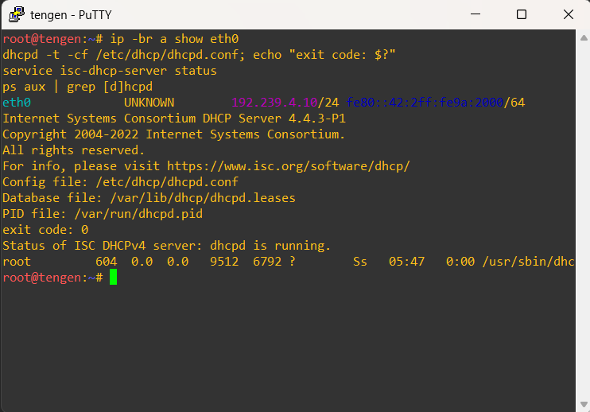

## 5. Kesimpulan

isc-dhcp-server pada tengen berjalan dengan deklarasi subnet Network 4 (tanpa pool) serta scope untuk Network 2 dan Network 3. Konfigurasi lolos validasi dan service aktif tanpa error "No subnet declaration". Pembuktian pemberian lease ke klien melalui relay dilakukan pada soal 3.

## 6. Pemulihan setelah restart

```bash
service isc-dhcp-server restart
# jika dhcpd.conf atau paket hilang:
/root/setup-tengen.sh
```

# SOAL 3 | DHCP Relay pada jichi

Kelompok: K56 | Prefix IP: `192.239.x.x`

> Permintaan alamat dari Divisi A dan Divisi B tidak dapat menyeberangi subnet secara langsung. Konfigurasikan jichi sebagai DHCP Relay menuju tengen ([PREFIX IP].4.10), menggunakan eth2 untuk Network 2 dan eth3 untuk Network 3. Buktikan bahwa client dari kedua subnet berhasil memperoleh lease melalui relay.

## 1. Tujuan

Permintaan alamat dari Divisi A dan Divisi B tidak dapat menyeberangi subnet secara langsung (broadcast tidak dilewatkan router). jichi dikonfigurasi sebagai DHCP Relay menuju tengen (`192.239.4.10`):

- `eth2` untuk Network 2
- `eth3` untuk Network 3
- Membuktikan klien kedua subnet memperoleh lease melalui relay

## 2. Alur kerja relay

```
Klien (N2/N3) --broadcast DISCOVER--> jichi (eth2/eth3)
jichi --unicast, giaddr = IP interface penerima--> tengen (192.239.4.10)
tengen --OFFER/ACK ke giaddr--> jichi --> Klien
```

| Klien | Interface jichi penerima | giaddr |
|---|---|---|
| Network 2 | eth2 | 192.239.2.1 |
| Network 3 | eth3 | 192.239.3.1 |

## 3. Konfigurasi

### 3.1 `/etc/default/isc-dhcp-relay` pada jichi

```
SERVERS="192.239.4.10"
INTERFACES=""
OPTIONS="-id eth2 -id eth3 -iu eth4"
```

- `-id eth2 -id eth3`: interface sisi klien (downstream)
- `-iu eth4`: interface sisi server (upstream) menuju Data Center

### 3.2 Bagian relay pada `/root/setup-jichi.sh`

```bash
apt update && apt install -y isc-dhcp-relay

cat > /etc/default/isc-dhcp-relay <<'EOF'
SERVERS="192.239.4.10"
INTERFACES=""
OPTIONS="-id eth2 -id eth3 -iu eth4"
EOF

service isc-dhcp-relay restart
service isc-dhcp-relay status
```

### 3.3 Klien menggunakan DHCP

`/etc/network/interfaces` pada itadori, fushiguro, zenin, okkotsu, ino, kusakabe, miwa, dan kugisaki:

```
auto eth0
iface eth0 inet dhcp
```

## 4. Pembuktian

### 4.1 jichi

```bash
cat /etc/default/isc-dhcp-relay
ps aux | grep [d]hcrelay
```

Hasil yang diharapkan: tujuan `192.239.4.10`, proses `dhcrelay -q -id eth2 -id eth3 -iu eth4 192.239.4.10`.


### 4.2 Klien Network 2 (itadori)

```bash
ifdown eth0; ifup eth0
ip -br a show eth0
ip route | grep default
```

Hasil: `lease of 192.239.2.x obtained from 192.239.4.10`, IP `192.239.2.x/24`, default route `192.239.2.1`.


### 4.3 Klien Network 3 (miwa)

Perintah sama seperti di atas.

Hasil: `lease of 192.239.3.x obtained from 192.239.4.10`, IP `192.239.3.x/24`, default route `192.239.3.1`.


### 4.4 Sisi server (tengen)

```bash
grep -E "^lease|hardware ethernet" /var/lib/dhcp/dhcpd.leases | tail -n 20
```

Hasil: terdapat lease untuk `192.239.2.x` dan `192.239.3.x` beserta MAC klien, membuktikan permintaan dari kedua subnet sampai ke tengen.

> Screenshot: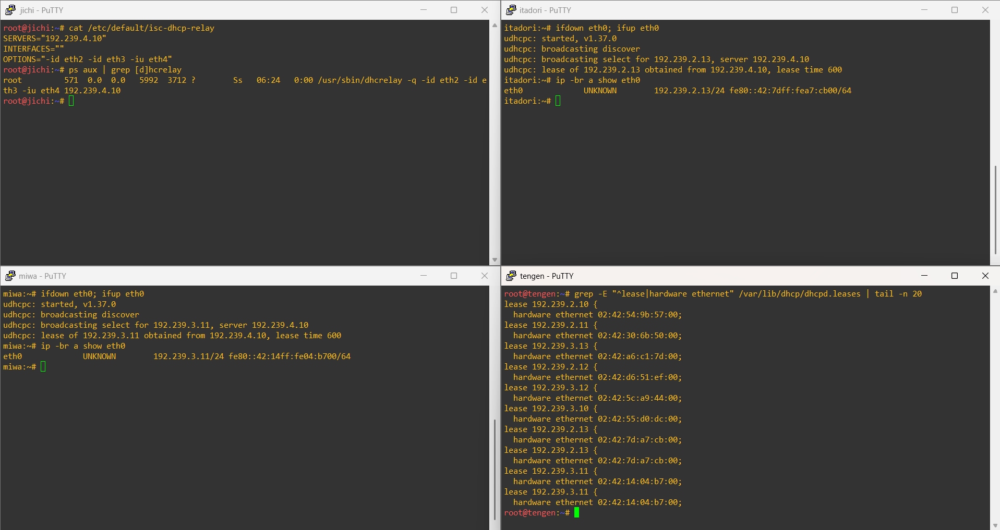

## 5. Kesimpulan

jichi berfungsi sebagai DHCP Relay: eth2 dan eth3 menerima broadcast dari Network 2 dan 3, meneruskannya ke tengen (`192.239.4.10`) lewat eth4, dan membawa balasan kembali ke klien. Klien kedua subnet berhasil memperoleh lease dari tengen.

## 6. Pemulihan setelah restart

```bash
./setup-jichi.sh
```

Script ini menulis ulang konfigurasi relay yang benar dan menjalankan service.


# SOAL 4 | Dua Pool DHCP pada Network 2

Kelompok: K56 | Prefix IP: `192.239.x.x`

> Agar tim Dev dan Support di Divisi A menerima jatah alamat yang berbeda, atur dua pool DHCP pada Network 2. Tetapkan Pool 1 ([PREFIX IP].2.10–[PREFIX IP].2.35) untuk itadori dan fushiguro, serta Pool 2 ([PREFIX IP].2.70–[PREFIX IP].2.95) untuk zenin dan okkotsu. Rentang [PREFIX IP].2.36–[PREFIX IP].2.69 tidak boleh dialokasikan. Karena seluruh client berada pada subnet yang sama, gunakan DHCP class berdasarkan MAC Address atau Client ID untuk memisahkan kedua kelompok.

## 1. Tujuan

Tim Dev dan Support di Divisi A menerima jatah alamat yang berbeda. Dua pool dibuat pada Network 2:

| Pool | Rentang | Klien |
|---|---|---|
| Pool 1 | 192.239.2.10 – 192.239.2.35 | itadori, fushiguro |
| Pool 2 | 192.239.2.70 – 192.239.2.95 | zenin, okkotsu |

Rentang `192.239.2.36 – 192.239.2.69` tidak boleh dialokasikan. Karena seluruh klien berada pada subnet yang sama, pemisahan dilakukan dengan DHCP class berdasarkan MAC Address.

## 2. Rancangan

- Setiap kelompok klien didefinisikan sebagai `class` yang dicocokkan dengan MAC (`substring(hardware, 1, 6)`).
- Setiap `pool` dibatasi dengan `allow members of "<class>"`, sehingga hanya anggota class tersebut yang dilayani dari range pool itu.
- Rentang `.36–.69` tidak dimasukkan ke range manapun, sehingga tidak pernah dialokasikan.

### Pemetaan MAC

MAC diambil dari tiap klien dengan `ip link show eth0 | grep ether`.

| Klien | MAC | Class |
|---|---|---|
| itadori | 02:42:7d:a7:cb:00 | pool1 |
| fushiguro | 02:42:d6:51:ef:00 | pool1 |
| zenin | f2:dd:ec:51:c9:cb | pool2 |
| okkotsu | 02:42:54:9b:57:00 | pool2 |

Catatan: MAC zenin sebelumnya `02:42:30:6b:50:00` dan berubah setelah node di-restart/dibuat ulang (lihat bagian 4).

## 3. Konfigurasi

Blok Network 2 pada heredoc `dhcpd.conf` di `/root/setup-tengen.sh`:

```
# Network 2 (Divisi A)
class "pool1" {
    match if (substring(hardware, 1, 6) = 02:42:7d:a7:cb:00)
          or (substring(hardware, 1, 6) = 02:42:d6:51:ef:00);
}

class "pool2" {
    match if (substring(hardware, 1, 6) = f2:dd:ec:51:c9:cb)
          or (substring(hardware, 1, 6) = 02:42:54:9b:57:00);
}

subnet 192.239.2.0 netmask 255.255.255.0 {
    option routers 192.239.2.1;
    option subnet-mask 255.255.255.0;

    pool {
        allow members of "pool1";
        range 192.239.2.10 192.239.2.35;
    }

    pool {
        allow members of "pool2";
        range 192.239.2.70 192.239.2.95;
    }
}
```

Terapkan dan validasi:

```bash
./setup-tengen.sh
dhcpd -t -cf /etc/dhcp/dhcpd.conf; echo "exit code: $?"
```

Karena klien masih memegang lease dari range lama, lease dikosongkan agar klien meminta ulang:

```bash
service isc-dhcp-server stop
: > /var/lib/dhcp/dhcpd.leases
service isc-dhcp-server start
```

Lalu pada tiap klien Network 2:

```bash
ifdown eth0; ifup eth0
```

## 4. Pembuktian

### 4.1 Klien Network 2

Pada itadori, fushiguro, zenin, dan okkotsu:

```bash
ip link show eth0 | grep ether
ifdown eth0; ifup eth0
ip -4 addr show eth0
```

| Klien | IP yang diharapkan |
|---|---|
| itadori, fushiguro | 192.239.2.10 – .35 |
| zenin, okkotsu | 192.239.2.70 – .95 |

Hasil terverifikasi sejauh ini:

- itadori: `192.239.2.11` (Pool 1)
- fushiguro: `192.239.2.14` (Pool 1)
- okkotsu: `192.239.2.70` (Pool 2)
- zenin: diverifikasi ulang setelah MAC diperbarui

> Screenshot: 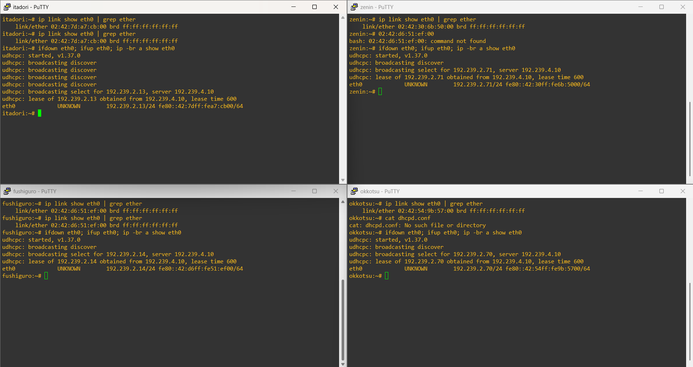

### 4.2 Sisi server (tengen)

```bash
cat /etc/dhcp/dhcpd.conf
dhcpd -t -cf /etc/dhcp/dhcpd.conf; echo "exit code: $?"
grep -E "^lease|hardware ethernet|^  binding state" /var/lib/dhcp/dhcpd.leases
```

Hasil yang diharapkan: konfigurasi memuat class dan dua pool, exit code `0`, dan tidak ada lease pada `192.239.2.36 – .69`.

> Screenshot:

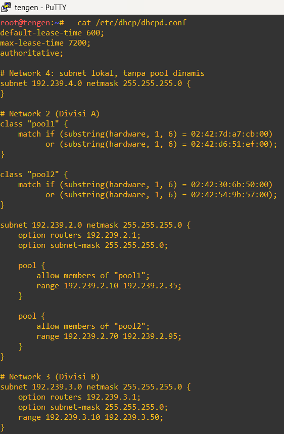
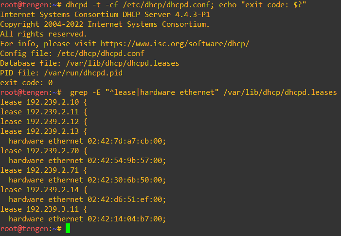

## 5. Kesimpulan

Network 2 dilayani dua pool terpisah berdasarkan class MAC: itadori dan fushiguro memperoleh alamat dari Pool 1, zenin dan okkotsu dari Pool 2, sedangkan rentang `.36–.69` tidak pernah dialokasikan.

## 6. Pemulihan setelah restart

Jika MAC klien berubah, cocokkan ulang dengan class di `dhcpd.conf` tengen:

```bash
ip link show eth0 | grep ether                       # di klien
grep -n "substring(hardware" /etc/dhcp/dhcpd.conf    # di tengen
```

Perbarui MAC yang berbeda pada `./setup-tengen.sh`, lalu jalankan ulang script.


# SOAL 5 | Short Lease dan Long Lease pada Network 3

Kelompok: K56 | Prefix IP: `192.239.x.x`

> Setiap tim lapangan memiliki durasi operasi yang berbeda. Pada Network 3, berikan short lease 30 menit (1800 detik) kepada ino dan kusakabe, serta long lease 12 jam (43200 detik) kepada miwa. Gunakan pool short lease [PREFIX IP].3.10–[PREFIX IP].3.89 dan pool long lease [PREFIX IP].3.100–[PREFIX IP].3.199. Sesuaikan default-lease-time dan max-lease-time untuk setiap kelas client. Berikan pula DHCP options berupa DNS [PREFIX IP].1.2 dan [PREFIX IP].1.3, serta domain-search <xxxx>.com.

## 1. Tujuan

Setiap tim lapangan memiliki durasi operasi yang berbeda. Pada Network 3:

| Kelas | Klien | Pool | Lease time |
|---|---|---|---|
| short | ino, kusakabe | 192.239.3.10 – 192.239.3.89 | 30 menit (1800 detik) |
| long | miwa | 192.239.3.100 – 192.239.3.199 | 12 jam (43200 detik) |

Tambahan: `default-lease-time` dan `max-lease-time` disesuaikan untuk setiap kelas klien, serta DHCP options berikut:

- DNS: `192.239.1.2` dan `192.239.1.3`
- Domain-search: `k56.com`

## 2. Rancangan

- Dua `class` berdasarkan MAC (`short` dan `long`), masing-masing memuat `default-lease-time` dan `max-lease-time` sendiri.
- Dua `pool`, masing-masing dibatasi dengan `allow members of`.
- `max-lease-time` disamakan dengan `default-lease-time` agar klien tidak dapat meminta lease lebih lama dari ketentuan.
- Option DNS dan domain-search diletakkan pada level subnet sehingga berlaku untuk seluruh klien Network 3.
- Rentang `.90–.99` dan `.200` ke atas tidak masuk pool manapun.

### Pemetaan MAC

| Klien | MAC | Class |
|---|---|---|
| ino / kusakabe | 02:42:a6:c1:7d:00 | short |
| kusakabe / ino | 02:42:55:d0:dc:00 | short |
| miwa | 02:42:14:04:b7:00 | long |

Catatan: dua MAC pada class short dimiliki ino dan kusakabe; urutan di antara keduanya tidak berpengaruh karena keduanya satu class. kugisaki berada di luar kedua class (fixed address, soal 6).

## 3. Konfigurasi

Blok Network 3 pada heredoc `dhcpd.conf` di `/root/setup-tengen.sh`:

```
# Network 3 (Divisi B)
class "short" {
    match if (substring(hardware, 1, 6) = 02:42:a6:c1:7d:00)
          or (substring(hardware, 1, 6) = 02:42:55:d0:dc:00);
    default-lease-time 1800;
    max-lease-time 1800;
}

class "long" {
    match if (substring(hardware, 1, 6) = 02:42:14:04:b7:00);
    default-lease-time 43200;
    max-lease-time 43200;
}

subnet 192.239.3.0 netmask 255.255.255.0 {
    option routers 192.239.3.1;
    option subnet-mask 255.255.255.0;
    option domain-name-servers 192.239.1.2, 192.239.1.3;
    option domain-search "k56.com";

    pool {
        allow members of "short";
        range 192.239.3.10 192.239.3.89;
    }

    pool {
        allow members of "long";
        range 192.239.3.100 192.239.3.199;
    }
}
```

Terapkan dan validasi:

```bash
grep -n "MAC:" /root/setup-tengen.sh      # harus kosong
/root/setup-tengen.sh
dhcpd -t -cf /etc/dhcp/dhcpd.conf; echo "exit code: $?"
service isc-dhcp-server stop; : > /var/lib/dhcp/dhcpd.leases; service isc-dhcp-server start
```

### Kendala yang ditemui

| Kendala | Penyebab | Penyelesaian |
|---|---|---|
| `dhcpd -t` gagal pada class short | Prefix `MAC:` dari placeholder masih menempel pada nilai MAC | `sed -i 's/MAC://g' /root/setup-tengen.sh` |

## 4. Pembuktian

### 4.1 Klien Network 3

Pada ino, kusakabe, dan miwa:

```bash
ifdown eth0; ifup eth0
ip -br a show eth0
cat /etc/resolv.conf
```

| Klien | IP yang diharapkan | Lease time pada output `ifup` |
|---|---|---|
| ino, kusakabe | 192.239.3.10 – .89 | 1800 |
| miwa | 192.239.3.100 – .199 | 43200 |

Hasil terverifikasi sejauh ini:

- ino/kusakabe: `192.239.3.10` dan `192.239.3.11` (class short)
- miwa: `192.239.3.100` (class long)

`/etc/resolv.conf` berisi `nameserver 192.239.1.2` dan `nameserver 192.239.1.3`.


### 4.2 Bukti domain-search

Udhcpc pada klien Alpine hanya menuliskan DNS (option 6) ke `resolv.conf` dan tidak menuliskan domain-search (option 119), sehingga baris `search` tidak selalu tampil. Pembuktian dilakukan dari paket DHCP ACK di tengen:

```bash
tcpdump -vni eth0 port 67
```

Lalu renew satu klien; pada paket ACK terlihat option Domain-Name-Server (6) dan Domain-Search (119) berisi `k56.com`.

### 4.3 Sisi server (tengen)

```bash
cat /etc/dhcp/dhcpd.conf
dhcpd -t -cf /etc/dhcp/dhcpd.conf; echo "exit code: $?"
grep -E "^lease|hardware ethernet|ends" /var/lib/dhcp/dhcpd.leases
```

Hasil yang diharapkan: exit code `0`, tidak ada lease pada `192.239.3.90 – .99`, dan lease miwa berdurasi jauh lebih panjang daripada ino dan kusakabe.

> Screenshot:

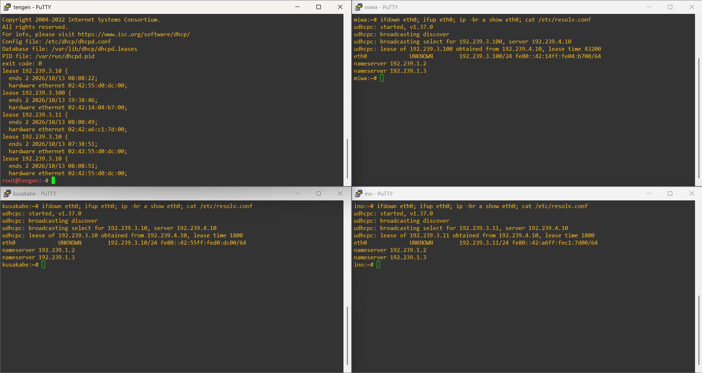

## 5. Kesimpulan

Network 3 dilayani dua kelas lease: ino dan kusakabe memperoleh alamat `.3.10–.3.89` dengan lease 1800 detik, sedangkan miwa memperoleh alamat `.3.100–.3.199` dengan lease 43200 detik. Seluruh klien Network 3 menerima DNS `192.239.1.2` dan `192.239.1.3` serta domain-search `k56.com`.

## 6. Pemulihan setelah restart

Jika MAC klien berubah, cocokkan ulang dengan class di tengen:

```bash
grep -n "substring(hardware" /etc/dhcp/dhcpd.conf
```

Perbarui MAC yang berbeda pada `./setup-tengen.sh`, jalankan ulang script, lalu reset lease.


# Soal 6 – Fixed Address untuk kugisaki

Kelompok: K56 | Prefix IP: `192.239.x.x`

> Kugisaki ditetapkan sebagai personel VIP yang harus mempertahankan alamat yang sama setiap kali terhubung. Buat DHCP static lease berdasarkan MAC Address client tersebut dengan fixed address [PREFIX IP].3.99. Pastikan alamat ini berada di luar seluruh pool dinamis, validasi konfigurasi server, lalu renew lease pada client. Buktikan bahwa alamat yang diterima sesuai dengan reservasi.

## 1. Tujuan

kugisaki ditetapkan sebagai personel VIP yang harus mempertahankan alamat yang sama setiap kali terhubung:

- DHCP static lease berdasarkan MAC Address kugisaki
- Fixed address `192.239.3.99`
- Alamat berada di luar seluruh pool dinamis
- Validasi konfigurasi server, renew lease pada klien, dan buktikan alamat sesuai reservasi

## 2. Rancangan

`192.239.3.99` berada di luar kedua pool dinamis Network 3, sehingga tidak berpotensi bentrok dengan alokasi dinamis:

| Pool | Rentang |
|---|---|
| short | 192.239.3.10 – 192.239.3.89 |
| (fixed kugisaki) | **192.239.3.99** |
| long | 192.239.3.100 – 192.239.3.199 |

Reservasi dibuat dengan blok `host` berdasarkan MAC. Option router, DNS, dan domain-search tetap diambil dari blok subnet Network 3. Lease time kugisaki memakai default global (600 detik) karena soal tidak meminta nilai khusus.

### MAC kugisaki

Diambil pada kugisaki:

```bash
ip link show eth0 | grep ether
```

Hasil: `02:42:5c:a9:44:00`

## 3. Konfigurasi

Blok `host` pada heredoc `dhcpd.conf` di `/root/setup-tengen.sh`, ditempatkan setelah blok subnet Network 3:

```
host kugisaki {
    hardware ethernet 02:42:5c:a9:44:00;
    fixed-address 192.239.3.99;
}
```

Terapkan dan validasi pada tengen:

```bash
/root/setup-tengen.sh
dhcpd -t -cf /etc/dhcp/dhcpd.conf; echo "exit code: $?"
service isc-dhcp-server restart
service isc-dhcp-server status
```

Renew lease pada kugisaki:

```bash
ifdown eth0; ifup eth0
ip -br a show eth0
ip route | grep default
```

### Kendala yang ditemui

| Kendala | Penyebab | Penyelesaian |
|---|---|---|
| `ifdown: command not found` saat dijalankan di tengen | Perintah renew dijalankan di node server, bukan di klien | Jalankan `ifdown/ifup` pada kugisaki |
| `dhcpd.leases` belum memuat `192.239.3.99` setelah validasi | Konfigurasi baru belum dipakai service dan kugisaki belum meminta ulang | Restart service, lalu renew pada kugisaki |

## 4. Pembuktian

### 4.1 Sisi server (tengen)

```bash
grep -B1 -A4 "host kugisaki" /etc/dhcp/dhcpd.conf
dhcpd -t -cf /etc/dhcp/dhcpd.conf; echo "exit code: $?"
grep -A8 "192.239.3.99" /var/lib/dhcp/dhcpd.leases
```

Hasil: blok `host kugisaki` memuat MAC `02:42:5c:a9:44:00` dan fixed-address `192.239.3.99`, `dhcpd -t` exit code `0`, dan lease `192.239.3.99` tercatat dengan MAC kugisaki.

### 4.2 Klien (kugisaki)

Output renew:

```
udhcpc: broadcasting select for 192.239.3.99, server 192.239.4.10
udhcpc: lease of 192.239.3.99 obtained from 192.239.4.10, lease time 600
eth0   UNKNOWN   192.239.3.99/24 fe80::42:5cff:fea9:4400/64
default via 192.239.3.1 dev eth0
```

Alamat yang diterima (`192.239.3.99`) sesuai dengan reservasi, dengan gateway `192.239.3.1`.

Untuk membuktikan alamat tetap, renew diulang:

```bash
ifdown eth0; ifup eth0; ip -br a show eth0
```

Hasil: tetap `192.239.3.99/24`.

> Screenshot: 
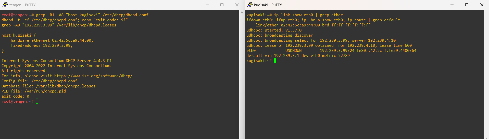

## 5. Kesimpulan

kugisaki memperoleh alamat tetap `192.239.3.99` dari tengen (`192.239.4.10`) berdasarkan MAC `02:42:5c:a9:44:00`. Alamat ini berada di luar pool short dan long, validasi konfigurasi lolos, dan alamat tetap sama setiap lease diperbarui.

## 6. Pemulihan setelah restart

Jika MAC kugisaki berubah, perbarui blok `host` pada `/root/setup-tengen.sh`:

```bash
ip link show eth0 | grep ether       # di kugisaki
grep -A3 "host kugisaki" /etc/dhcp/dhcpd.conf   # di tengen
```

Lalu jalankan ulang `/root/setup-tengen.sh` dan renew pada kugisaki.


# Soal 7 – Verifikasi Konfigurasi Jaringan Klien

Kelompok: K56 | Prefix IP: `192.239`

> Setelah aturan alokasi diterapkan, pastikan setiap client menerima konfigurasi jaringan sesuai wilayahnya: subnet mask 255.255.255.0 (/24), gateway dan broadcast address yang benar, DNS [PREFIX IP].1.2 serta [PREFIX IP].1.3, dan domain-search yang ditentukan. Periksa IP address dan routing seluruh client Divisi A dan Divisi B, kemudian cocokkan lease dengan /var/lib/dhcp/dhcpd.leases pada tengen. Pastikan tidak ada alamat yang bertabrakan atau berada di luar kebijakan pool.

## 1. Tujuan

Setelah aturan alokasi diterapkan, setiap klien harus menerima konfigurasi jaringan sesuai wilayahnya:

- Subnet mask `255.255.255.0` (/24)
- Gateway dan broadcast address yang benar
- DNS `192.239.1.2` dan `192.239.1.3`
- Domain-search yang ditentukan (`k56.com`)
- Mencocokkan lease klien Divisi A dan B dengan `/var/lib/dhcp/dhcpd.leases` pada tengen
- Memastikan tidak ada alamat bertabrakan atau di luar kebijakan pool

## 2. Perbaikan konfigurasi sebelum verifikasi

Pada `dhcpd.conf` sebelumnya, subnet Network 2 belum memiliki DNS dan domain-search, dan kedua subnet belum memiliki broadcast address. Ditambahkan pada `/root/setup-tengen.sh`:

```
# Network 2
option broadcast-address 192.239.2.255;
option domain-name-servers 192.239.1.2, 192.239.1.3;
option domain-search "k56.com";

# Network 3
option broadcast-address 192.239.3.255;
option domain-name-servers 192.239.1.2, 192.239.1.3;
option domain-search "k56.com";
```

Penambahan dilakukan dengan `sed` pada baris `option routers`, lalu diverifikasi:

```bash
grep -n "broadcast\|domain" /root/setup-tengen.sh
```

Hasil: terdapat dua baris broadcast, dua baris DNS, dan dua baris domain-search (Network 2 dan Network 3). Script dijalankan ulang dan lease direset:

```bash
/root/setup-tengen.sh
dhcpd -t -cf /etc/dhcp/dhcpd.conf; echo "exit code: $?"
service isc-dhcp-server stop; : > /var/lib/dhcp/dhcpd.leases; service isc-dhcp-server start
```

`dhcpd -t` menghasilkan `exit code: 0` dan service berjalan.

## 3. Ketentuan yang diharapkan

| Klien | Network | Rentang IP | Gateway | Broadcast | Lease time |
|---|---|---|---|---|---|
| itadori, fushiguro | 2 | 192.239.2.10 – .35 | 192.239.2.1 | 192.239.2.255 | 600 |
| zenin, okkotsu | 2 | 192.239.2.70 – .95 | 192.239.2.1 | 192.239.2.255 | 600 |
| ino, kusakabe | 3 | 192.239.3.10 – .89 | 192.239.3.1 | 192.239.3.255 | 1800 |
| miwa | 3 | 192.239.3.100 – .199 | 192.239.3.1 | 192.239.3.255 | 43200 |
| kugisaki | 3 | 192.239.3.99 (fixed) | 192.239.3.1 | 192.239.3.255 | 600 |

Semua klien: mask /24, DNS `192.239.1.2` dan `192.239.1.3`, domain-search `k56.com`.

## 4. Pemeriksaan pada klien

Dijalankan pada kedelapan klien:

```bash
ifdown eth0; ifup eth0
ip -4 addr show eth0
ip route
cat /etc/resolv.conf
```

### Contoh hasil: fushiguro

```
udhcpc: lease of 192.239.2.14 obtained from 192.239.4.10, lease time 600
inet 192.239.2.14/24 brd 192.239.2.255 scope global eth0
default via 192.239.2.1 dev eth0
192.239.2.0/24 dev eth0 proto kernel scope link src 192.239.2.14
nameserver 192.239.1.2
nameserver 192.239.1.3
```

Hasil ini sesuai: IP berada di Pool 1, mask /24, broadcast `192.239.2.255`, gateway `192.239.2.1`, dan DNS benar.

### Tabel hasil seluruh klien

Isi dari output masing-masing klien:

| Klien | IP | Broadcast | Gateway | Lease time | DNS | Sesuai |
|---|---|---|---|---|---|---|
| itadori | | | | | | |
| fushiguro | 192.239.2.14 | 192.239.2.255 | 192.239.2.1 | 600 | 192.239.1.2, .1.3 | ya |
| zenin | | | | | | |
| okkotsu | | | | | | |
| ino | | | | | | |
| kusakabe | | | | | | |
| miwa | | | | | | |
| kugisaki | | | | | | |

> Screenshot:

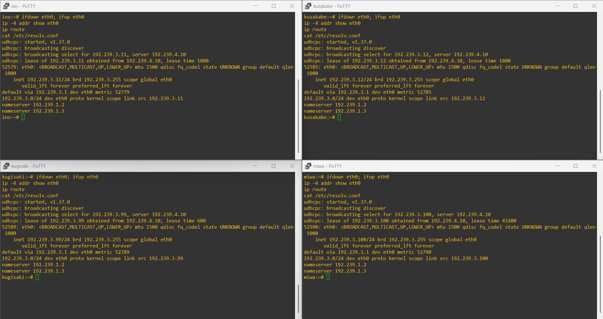
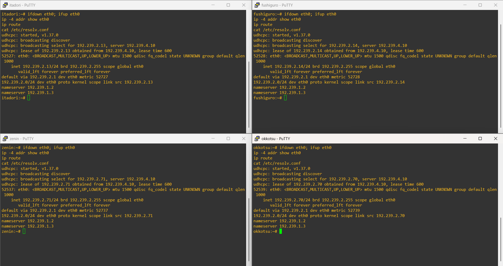

### Catatan domain-search

Udhcpc pada klien Alpine hanya menuliskan DNS (option 6) ke `/etc/resolv.conf` dan tidak memproses domain-search (option 119), sehingga baris `search k56.com` tidak tampil di klien. Option tersebut tetap dikirim server dan dibuktikan dari paket DHCP ACK di tengen:

```bash
tcpdump -vni eth0 port 67 or port 68
```

Pada paket ACK terlihat Domain-Name-Server (6) berisi `192.239.1.2, 192.239.1.3` dan Domain-Search (119) berisi `k56.com`.

## 5. Pencocokan dengan `dhcpd.leases` pada tengen

Daftar lease terakhir per IP (file bersifat append-only, sehingga entri terakhir yang berlaku):

```bash
awk '/^lease/{ip=$2} /^  binding state/{st=$3} /hardware ethernet/{mac=$3} /^}/{a[ip]=ip" "mac" "st} END{for(i in a) print a[i]}' /var/lib/dhcp/dhcpd.leases | tr -d ';' | sort -V
```

Contoh data lease yang terekam:

| IP | MAC | Pool |
|---|---|---|
| 192.239.2.10 | 02:42:d6:51:ef:00 | Pool 1 |
| 192.239.2.13 | 02:42:7d:a7:cb:00 | Pool 1 (itadori) |
| 192.239.2.70 | 02:42:54:9b:57:00 | Pool 2 (okkotsu) |
| 192.239.2.71 | 02:42:30:6b:50:00 | Pool 2 |
| 192.239.3.10 | 02:42:a6:c1:7d:00 | short |
| 192.239.3.11 | 02:42:55:d0:dc:00 | short |
| 192.239.3.100 | 02:42:14:04:b7:00 | long (miwa) |
| 192.239.3.99 | 02:42:5c:a9:44:00 | fixed (kugisaki) |

Ganti dengan output terbaru setelah seluruh klien melakukan renew.

### Pemeriksaan kebijakan

- **Tabrakan IP**: setiap IP hanya memiliki satu MAC dan setiap MAC hanya satu IP.
- **Di luar pool**: tidak ada lease pada `192.239.2.36 – .69`, `192.239.2.96` ke atas, `192.239.3.90 – .98`, dan `192.239.3.200` ke atas. Satu-satunya pengecualian adalah `192.239.3.99` milik kugisaki.
- **Pool sesuai klien**: itadori dan fushiguro berada di `.2.10–.35`, zenin dan okkotsu di `.2.70–.95`, ino dan kusakabe di `.3.10–.89`, miwa di `.3.100–.199`.

> Screenshot: 

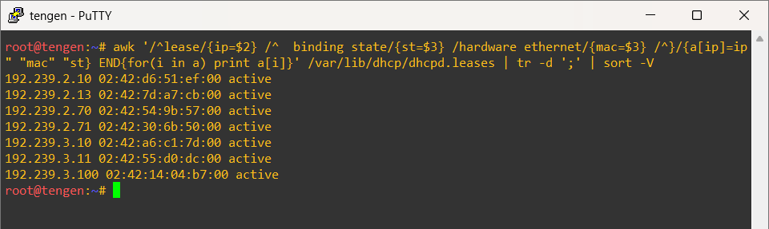

## 7. Kesimpulan

Seluruh klien Divisi A dan B menerima mask /24, gateway dan broadcast sesuai subnetnya, serta DNS `192.239.1.2` dan `192.239.1.3`. Domain-search `k56.com` terkirim dari server dan terbukti pada paket ACK. Lease pada tengen sesuai kebijakan pool: tidak ada tabrakan alamat dan tidak ada alamat di luar rentang yang ditentukan.


# Soal 8 – Packet Capture Proses DHCP (DORA)

Kelompok: K56 | Prefix IP: `192.239`

> Sebelum Curtain dibuka kembali, buktikan bahwa proses pemberian alamat berjalan sesuai protokol. Lakukan packet capture saat salah satu client Network 2 atau Network 3 meminta lease baru. Gunakan tcpdump pada tengen atau jalur menuju Data Center untuk menunjukkan urutan DHCPDISCOVER → DHCPOFFER → DHCPREQUEST → DHCPACK. Identifikasi alamat server, alamat yang diberikan, lease time, dan field giaddr. Pastikan nilai giaddr sesuai dengan interface jichi yang menerima request dari subnet client.

## 1. Tujuan

Membuktikan proses pemberian alamat berjalan sesuai protokol dengan packet capture saat klien Network 2 atau 3 meminta lease baru:

- Menunjukkan urutan DHCPDISCOVER → DHCPOFFER → DHCPREQUEST → DHCPACK
- Mengidentifikasi alamat server, alamat yang diberikan, lease time, dan field giaddr
- Memastikan giaddr sesuai dengan interface jichi yang menerima request dari subnet klien

## 2. Metode

Capture dijalankan pada tengen (`eth0`), yaitu jalur menuju Data Center, dengan mode verbose:

```bash
tcpdump -vvv -ni eth0 -s 0 'port 67 or port 68' | grep -E "Discover|Offer|Request|ACK|Gateway-IP|Server-ID|Your-IP|Lease-Time|Client-Ethernet"
```

Untuk melihat header penuh (alamat sumber dan tujuan tiap paket), capture dapat disimpan lalu dibaca ulang tanpa filter:

```bash
tcpdump -vvv -ni eth0 -s 0 'port 67 or port 68' -w /root/dora.pcap
tcpdump -vvv -nr /root/dora.pcap
```

Pada klien itadori (Network 2), lease baru dipicu dengan:

```bash
ifdown eth0; ifup eth0
```

Karena request melewati relay, paket pada tengen tampak sebagai unicast antara `192.239.4.1` (jichi eth4) dan `192.239.4.10` (tengen). Balasan tengen dikirim ke alamat giaddr, bukan langsung ke klien.

## 3. Hasil capture (klien itadori, MAC `02:42:7d:a7:cb:00`)

Seluruh paket memiliki xid yang sama (`0x36f56c36`), sehingga merupakan satu transaksi.

| # | Tipe | Informasi penting |
|---|---|---|
| 1 | DHCPDISCOVER | `192.239.4.1 > 192.239.4.10`, `Gateway-IP 192.239.2.1`, `Client-Ethernet-Address 02:42:7d:a7:cb:00` |
| 2 | DHCPOFFER | `Your-IP 192.239.2.11`, `Server-ID 192.239.4.10`, `Lease-Time 600`, `Gateway-IP 192.239.2.1` |
| 3 | DHCPREQUEST | `Requested-IP 192.239.2.11`, `Server-ID 192.239.4.10`, `Gateway-IP 192.239.2.1` |
| 4 | DHCPACK | `Your-IP 192.239.2.11`, `Server-ID 192.239.4.10`, `Lease-Time 600`, `Gateway-IP 192.239.2.1` |

> Screenshot:

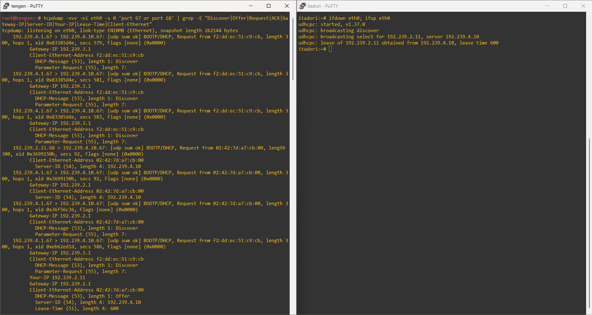

## 4. Identifikasi field

| Yang diminta | Nilai | Letak pada paket |
|---|---|---|
| Alamat server | `192.239.4.10` | Server-ID (option 54) |
| Alamat yang diberikan | `192.239.2.11` | Your-IP (yiaddr) pada Offer dan ACK |
| Lease time | 600 detik | Lease-Time (option 51) pada Offer dan ACK |
| giaddr | `192.239.2.1` | Gateway-IP pada header BOOTP |
| Pool | Pool 1 (`.2.10–.2.35`) | `192.239.2.11` berada dalam rentang |

## 5. Kesesuaian giaddr dengan interface jichi

Klien Network 2 terhubung ke jichi melalui `eth2`, sehingga giaddr yang ditulis relay adalah IP `eth2`. Klien Network 3 masuk melalui `eth3` dengan giaddr `192.239.3.1`.

| Subnet klien | Interface jichi | IP interface | giaddr pada paket |
|---|---|---|---|
| Network 2 | eth2 | 192.239.2.1 | 192.239.2.1 |
| Network 3 | eth3 | 192.239.3.1 | 192.239.3.1 |

Pembanding pada jichi:

```bash
ip -br a show eth2 eth3
```

Hasil: `eth2` bernilai `192.239.2.1/24` dan `eth3` bernilai `192.239.3.1/24`, sama dengan giaddr. Bukti tambahan: Offer dan ACK dari tengen dikirim ke `192.239.2.1` (giaddr), bukan ke `192.239.4.1`.


## 6. Temuan tambahan pada capture

- **Renew unicast**: terdapat paket `192.239.2.11.68 > 192.239.4.10.67` berisi Server-ID. Ini adalah perpanjangan lease oleh klien langsung ke server pada fase renewal, bukan bagian dari DORA.
- **Discover tanpa balasan dari MAC `f2:dd:ec:51:c9:cb`**: pada capture awal terdapat Discover berulang dengan `Gateway-IP 192.239.3.1` tanpa Offer. MAC tersebut kemudian diketahui milik zenin setelah MAC-nya berubah; karena tidak cocok dengan class `pool2`, tengen tidak menjawab (lihat soal 4). Giaddr `192.239.3.1` pada paket itu menunjukkan request masuk lewat eth3 (Network 3), padahal zenin seharusnya berada di Network 2. Letak kabel zenin pada topologi GNS3 perlu dipastikan.

## 7. Kesimpulan

Capture pada tengen menunjukkan urutan lengkap Discover, Offer, Request, dan ACK untuk klien itadori: server `192.239.4.10` memberikan alamat `192.239.2.11` dengan lease 600 detik. Nilai giaddr `192.239.2.1` sesuai dengan IP interface `eth2` jichi yang menerima request dari Network 2, dan balasan server dikirim ke giaddr tersebut, sehingga relay bekerja sebagaimana mestinya.


# Soal 9 – Simulasi Gangguan DHCP Relay

Kelompok: K56 | Prefix IP: `192.239`

> Sebuah gangguan memutus jalur relay dan membuat permintaan alamat tidak sampai ke Data Center. Hentikan service DHCP Relay pada jichi, lalu paksa salah satu client di Network 2 atau Network 3 meminta lease baru dan catat gejalanya. Pulihkan service relay, ulangi permintaan DHCP, lalu buktikan bahwa client kembali memperoleh alamat dari pool yang benar dengan gateway semula.

## 1. Tujuan

Sebuah gangguan memutus jalur relay sehingga permintaan alamat tidak sampai ke Data Center. Langkah yang dilakukan:

1. Menghentikan service DHCP Relay pada jichi
2. Memaksa klien Network 2 meminta lease baru dan mencatat gejalanya
3. Memulihkan service relay dan mengulangi permintaan DHCP
4. Membuktikan klien kembali memperoleh alamat dari pool yang benar dengan gateway semula

Klien uji: **itadori** (Network 2, Pool 1 `192.239.2.10 – .35`, gateway `192.239.2.1`).

## 2. Prosedur

### 2.1 Kondisi normal (pembanding)

Pada itadori:

```bash
ifdown eth0; ifup eth0
ip -4 addr show eth0; ip route | grep default
```

### 2.2 Hentikan relay

Pada jichi:

```bash
service isc-dhcp-relay stop
pkill dhcrelay
sleep 2
ps aux | grep [d]hcrelay
```

`ps` kosong menandakan relay mati.
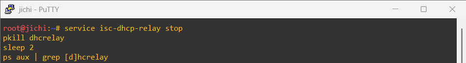

### 2.3 Paksa klien meminta lease baru

Pada itadori:

```bash
ifdown eth0
ip addr flush dev eth0
ifup eth0
ip -4 addr show eth0; ip route
```

Bukti pendukung (opsional), dijalankan sebelum `ifup`:

```bash
# jichi
tcpdump -ni eth2 port 67 or port 68
# tengen
tcpdump -ni eth0 port 67 or port 68
```

### 2.4 Pulihkan relay

Pada jichi:

```bash
service isc-dhcp-relay start
ps aux | grep [d]hcrelay
```

### 2.5 Ulangi permintaan DHCP

Pada itadori:

```bash
ifdown eth0; ifup eth0
ip -4 addr show eth0; ip route | grep default
```
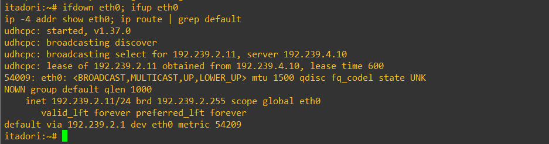

## 3. Hasil

### 3.1 Kondisi normal

```
udhcpc: lease of 192.239.2.11 obtained from 192.239.4.10, lease time 600
```

IP `192.239.2.11` (Pool 1) dari server `192.239.4.10`.


### 3.2 Relay dihentikan

Pada jichi, setelah `service isc-dhcp-relay stop`, `ps` sempat menampilkan entri `[dhcrelay]` berstatus `Ds` dengan ukuran 0, yaitu proses defunct yang sedang keluar dan tidak lagi berfungsi. Penambahan `pkill dhcrelay` dan `sleep 2` dilakukan agar `ps` bersih.


### 3.3 Gejala gangguan pada klien

```
udhcpc: started, v1.37.0
udhcpc: broadcasting discover
udhcpc: broadcasting discover
udhcpc: broadcasting discover
udhcpc: broadcasting discover
udhcpc: broadcasting discover
udhcpc failed to get a DHCP lease
udhcpc: no lease, forking to background
```

Gejala: discover dikirim berulang tanpa Offer, klien gagal memperoleh lease, dan `eth0` tidak memiliki alamat IPv4 maupun default route.

Penjelasan: broadcast DISCOVER klien hanya terjangkau sampai jichi. Tanpa relay, tidak ada proses yang meneruskannya ke tengen di Network 4, sehingga tengen tidak pernah menerima request dan tidak ada balasan.

> Screenshot: 
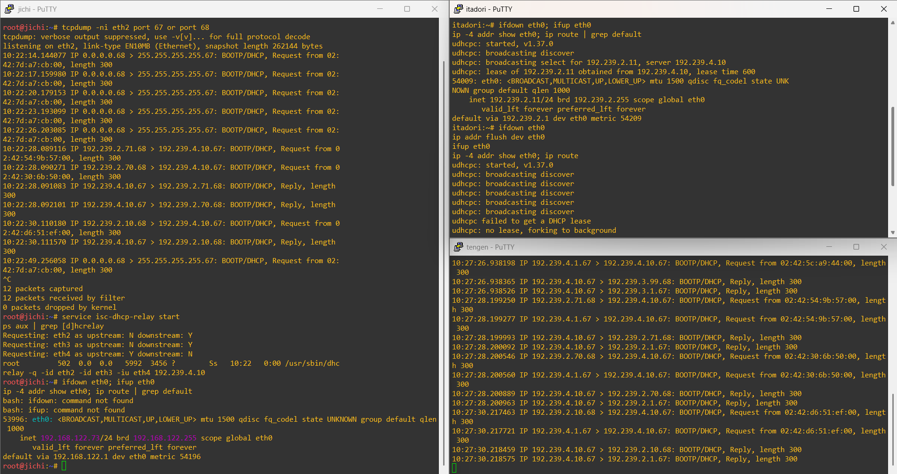

### 3.4 Relay dipulihkan

```
Requesting: eth2 as upstream: N downstream: Y
Requesting: eth3 as upstream: N downstream: Y
Requesting: eth4 as upstream: Y downstream: N
root  508  ...  /usr/sbin/dhcrelay -q -id eth2 -id eth3 -iu eth4 192.239.4.10
```

### 3.5 Klien kembali memperoleh alamat

```
udhcpc: broadcasting discover
udhcpc: broadcasting select for 192.239.2.11, server 192.239.4.10
udhcpc: lease of 192.239.2.11 obtained from 192.239.4.10, lease time 600
inet 192.239.2.11/24 brd 192.239.2.255 scope global eth0
default via 192.239.2.1 dev eth0
```

## 4. Perbandingan sebelum dan sesudah

| Tahap | Relay | Hasil pada itadori |
|---|---|---|
| Normal | aktif | `192.239.2.11/24`, gateway `192.239.2.1` |
| Gangguan | mati | discover berulang, `no lease`, tanpa IPv4 dan default route |
| Pemulihan | aktif kembali | `192.239.2.11/24`, gateway `192.239.2.1` |

IP berada dalam Pool 1 (`.2.10–.2.35`) dan gateway sama dengan kondisi awal.

## 5. Kesimpulan

Matinya relay pada jichi menghentikan seluruh pemberian alamat ke Network 2 dan 3 karena permintaan broadcast tidak dapat menyeberangi subnet. Setelah relay dipulihkan dengan konfigurasi `-id eth2 -id eth3 -iu eth4 192.239.4.10`, itadori kembali memperoleh lease dari tengen pada pool dan gateway yang benar.

## 6. Pemulihan cepat

```bash
service isc-dhcp-relay start
# jika gagal:
/root/setup-jichi.sh
```


# Soal 10 – Persistensi Layanan Setelah Restart

Kelompok: K56 | Prefix IP: `192.239`

> Setelah gangguan Shibuya tertangani, pastikan pemulihan bertahan setelah restart. Aktifkan autostart DHCP Server pada tengen dan DHCP Relay pada jichi, lalu restart kedua node. Verifikasi status layanan, IP, gateway, lease, dan konektivitas client Network 2–3. Pastikan kebijakan Pool 1, Pool 2, short lease, long lease, dan fixed address tetap berlaku.


## 1. Tujuan

Memastikan pemulihan bertahan setelah restart:

- Mengaktifkan autostart DHCP Server pada tengen dan DHCP Relay pada jichi
- Merestart kedua node
- Memverifikasi status layanan, IP, gateway, lease, dan konektivitas klien Network 2–3
- Memastikan kebijakan Pool 1, Pool 2, short lease, long lease, dan fixed address tetap berlaku

## 2. Pemeriksaan mekanisme init

Pada jichi dan tengen:

```bash
ps -p 1 -o comm=
which systemctl
ls /etc/init.d | grep dhcp
```

Hasil:

| Node | PID 1 | systemctl | Skrip init.d |
|---|---|---|---|
| jichi | `dumb-init` | tidak ada | `isc-dhcp-relay` |
| tengen | `dumb-init` | tidak ada | `isc-dhcp-server` |

`systemctl enable isc-dhcp-server` dan `systemctl enable isc-dhcp-relay` menghasilkan `systemctl: command not found`. Container tidak memakai systemd (PID 1 adalah `dumb-init`), sehingga `systemctl enable` dan `update-rc.d` tidak menjalankan layanan saat boot. Autostart dilakukan dengan hook `post-up` pada `/etc/network/interfaces`, yang dijalankan ketika interface naik saat node dinyalakan.

## 3. Konfigurasi autostart

### 3.1 tengen

`/etc/network/interfaces`:

```
auto eth0
iface eth0 inet static
    address 192.239.4.10
    netmask 255.255.255.0
    gateway 192.239.4.1
    post-up service isc-dhcp-server start
```

Verifikasi sebelum restart:

```bash
grep -A6 "eth0" /etc/network/interfaces
service isc-dhcp-server status
dhcpd -t -cf /etc/dhcp/dhcpd.conf; echo "exit code: $?"
```

Hasil: hook `post-up` terpasang, `dhcpd is running`, `exit code: 0`.

### 3.2 jichi

Skrip ringan `/root/autostart-jichi.sh` (tanpa `apt update` agar cepat dan tidak bergantung pada DNS saat boot):

```bash
#!/bin/bash
echo 1 > /proc/sys/net/ipv4/ip_forward
iptables -t nat -C POSTROUTING -o eth0 -j MASQUERADE 2>/dev/null || \
iptables -t nat -A POSTROUTING -o eth0 -j MASQUERADE
service isc-dhcp-relay restart
```

```bash
chmod +x /root/autostart-jichi.sh
```

`/etc/network/interfaces`, blok eth4 (interface terakhir, sehingga eth2 dan eth3 sudah aktif saat relay dijalankan):

```
auto eth4
iface eth4 inet static
    address 192.239.4.1
    netmask 255.255.255.0
    post-up /root/autostart-jichi.sh
```

Urutan interface dicek dengan `grep -n "^auto" /etc/network/interfaces`: eth0, eth1, eth2, eth3, eth4.

Skrip diuji manual sebelum restart:

```
root@jichi:~# ./autostart-jichi.sh
Requesting: eth2 as upstream: N downstream: Y
Requesting: eth3 as upstream: N downstream: Y
Requesting: eth4 as upstream: Y downstream: N

root  527  ...  /usr/sbin/dhcrelay -q -id eth2 -id eth3 -iu eth4 192.239.4.10
ip_forward = 1
-A POSTROUTING -o eth0 -j MASQUERADE
```

## 4. Restart

Dari GNS3: **Stop** lalu **Start** (bukan Delete/Reset). Urutan: tengen, jichi, lalu klien. Setelah node menyala, tidak ada layanan yang dijalankan secara manual.

## 5. Verifikasi setelah restart

### 5.1 tengen

```bash
ip -br a show eth0
ip route | grep default
service isc-dhcp-server status
ps aux | grep [d]hcpd
dhcpd -t -cf /etc/dhcp/dhcpd.conf; echo "exit code: $?"
```

Hasil: `192.239.4.10/24`, default via `192.239.4.1`, dhcpd running, `exit code: 0`. (isi dari output)

### 5.2 jichi

```bash
ip -br a
cat /proc/sys/net/ipv4/ip_forward
iptables -t nat -S POSTROUTING
ps aux | grep [d]hcrelay
```

Hasil: eth0 `192.168.122.x`, eth1 s.d. eth4 `192.239.1.1` s.d. `192.239.4.1`, `ip_forward = 1`, aturan MASQUERADE ada, dhcrelay berjalan dengan `-id eth2 -id eth3 -iu eth4 192.239.4.10`. (isi dari output)

> Screenshot: 
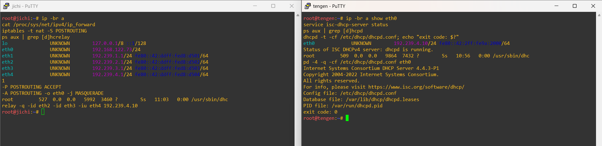

### 5.3 Klien Network 2 dan 3

```bash
ifdown eth0; ifup eth0
ip -4 addr show eth0
ip route | grep default
```

| Klien | IP yang diharapkan | Gateway | Lease | Hasil |
|---|---|---|---|---|
| itadori | 192.239.2.10 – .35 | 192.239.2.1 | 600 | |
| fushiguro | 192.239.2.10 – .35 | 192.239.2.1 | 600 | |
| zenin | 192.239.2.70 – .95 | 192.239.2.1 | 600 | |
| okkotsu | 192.239.2.70 – .95 | 192.239.2.1 | 600 | |
| ino | 192.239.3.10 – .89 | 192.239.3.1 | 1800 | |
| kusakabe | 192.239.3.10 – .89 | 192.239.3.1 | 1800 | |
| miwa | 192.239.3.100 – .199 | 192.239.3.1 | 43200 | |
| kugisaki | 192.239.3.99 (fixed) | 192.239.3.1 | 600 | |

> Screenshot: 

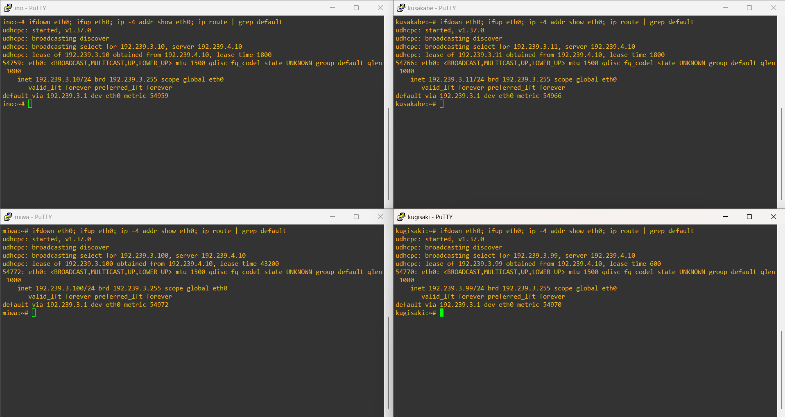
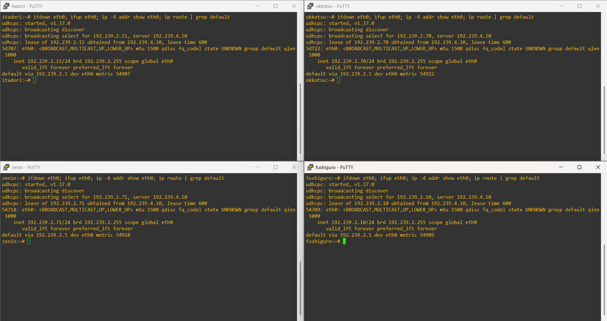

Konektivitas, dari satu klien Network 2 dan satu klien Network 3:

```bash
ping -c2 192.239.4.10
ping -c2 8.8.8.8
```

### 5.4 Kebijakan pool pada lease tengen

```bash
grep -E "^lease|hardware ethernet|^  binding state" /var/lib/dhcp/dhcpd.leases
```

Pemeriksaan: Pool 1 (`.2.10–.35`) untuk itadori dan fushiguro, Pool 2 (`.2.70–.95`) untuk zenin dan okkotsu, short lease (`.3.10–.89`, 1800 detik) untuk ino dan kusakabe, long lease (`.3.100–.199`, 43200 detik) untuk miwa, dan fixed `192.239.3.99` untuk kugisaki. Tidak ada lease pada `.2.36–.69`, `.2.96` ke atas, `.3.90–.98`, atau `.3.200` ke atas (selain `.3.99`).

## 6. Temuan: MAC zenin berubah

Setelah restart, zenin tidak memperoleh lease (discover berulang tanpa balasan). Penyebabnya, MAC zenin berubah dari `02:42:30:6b:50:00` menjadi `f2:dd:ec:51:c9:cb`, sehingga tidak cocok dengan class `pool2` pada `dhcpd.conf`.

Perbaikan pada tengen:

```bash
sed -i 's/02:42:30:6b:50:00/f2:dd:ec:51:c9:cb/' /root/setup-tengen.sh
/root/setup-tengen.sh
dhcpd -t -cf /etc/dhcp/dhcpd.conf; echo "exit code: $?"
```

Lalu renew pada zenin; IP yang benar berada pada `192.239.2.70 – .95`.

Pelajaran: kebijakan berbasis MAC bergantung pada MAC node GNS3 yang dapat berubah. Setelah restart atau pembuatan ulang node, MAC tiap klien perlu dicocokkan kembali dengan class pada `dhcpd.conf`.

## 7. Kesimpulan

Autostart dikonfigurasi dengan hook `post-up` karena container berjalan di bawah `dumb-init` tanpa systemd: DHCP Server pada tengen dan DHCP Relay (beserta IP forwarding dan NAT) pada jichi. Setelah restart, layanan aktif tanpa intervensi manual dan klien Network 2–3 kembali memperoleh alamat sesuai kebijakan Pool 1, Pool 2, short lease, long lease, dan fixed address.

---
### 11. Konfigurasi DNS Master–Slave Menggunakan BIND9
---

Pada nomor 11, dilakukan konfigurasi layanan DNS menggunakan BIND9 dengan **Utahime sebagai DNS Master** dan **Shoko sebagai DNS Slave** untuk domain `jujutsu.56.com`. DNS Master berfungsi menyimpan data zona utama, sedangkan DNS Slave menerima salinan data melalui mekanisme *zone transfer* sehingga kedua server dapat melayani permintaan DNS dengan informasi yang konsisten.

Konfigurasi pada Utahime dilakukan dengan menentukan zona bertipe `master` dan memberikan izin transfer zona ke Shoko (`192.239.1.3`). Sementara itu, Shoko dikonfigurasikan sebagai `slave` yang memperoleh data zona dari Utahime (`192.239.1.2`).

Contoh konfigurasi zona pada DNS Master adalah:

```conf
zone "jujutsu.56.com" {
    type master;
    file "/etc/bind/db.jujutsu.56.com";
    allow-transfer { 192.239.1.3; };
};
```

Sedangkan pada DNS Slave:

```conf
zone "jujutsu.56.com" {
    type slave;
    masters { 192.239.1.2; };
    file "/var/cache/bind/db.jujutsu.56.com";
};
```

Lokasi file tersebut merupakan contoh struktur konfigurasi BIND9. Lokasi aktual mengikuti konfigurasi script yang digunakan.

Setelah konfigurasi selesai, dilakukan pengujian record SOA dan NS melalui kedua server DNS menggunakan perintah:

```bash
dig @192.239.1.2 jujutsu.56.com SOA +short
dig @192.239.1.3 jujutsu.56.com SOA +short

dig @192.239.1.2 jujutsu.56.com NS +short
dig @192.239.1.3 jujutsu.56.com NS +short
```

Hasil pengujian SOA menunjukkan bahwa Utahime dan Shoko memberikan informasi zona yang sama, dengan server otoritatif `utahime.jujutsu.56.com` dan serial `2026101704`. Pengujian NS menunjukkan bahwa domain memiliki dua name server, yaitu `utahime.jujutsu.56.com` dan `shoko.jujutsu.56.com`.

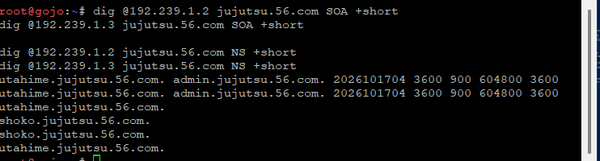

Berdasarkan hasil tersebut, kedua server berhasil memberikan jawaban DNS yang konsisten. Kesamaan serial SOA mendukung bahwa sinkronisasi zona antara Master dan Slave telah berjalan.

---

### 12. Konfigurasi DNS Record dan DNS Forwarding
---

Pada nomor 12, dilakukan konfigurasi DNS Record yang meliputi **A Record, CNAME, dan PTR**, serta DNS Forwarding untuk menerjemahkan domain eksternal. A Record berfungsi menghubungkan domain dengan alamat IPv4, CNAME membuat alias domain, sedangkan PTR digunakan untuk melakukan reverse lookup dari alamat IP menuju nama domain.

Domain `jujutsu.56.com` diarahkan ke Gojo (`192.239.1.4`) sebagai pintu masuk layanan web. Domain `www.jujutsu.56.com` dikonfigurasikan sebagai alias dari domain utama.

Pembagian record DNS adalah sebagai berikut.

| Record | Nama | Hasil |
|---|---|---|
| A | `jujutsu.56.com` | `192.239.1.4` |
| CNAME | `www.jujutsu.56.com` | `jujutsu.56.com` |
| PTR | IP pada reverse zone | `jujutsu.56.com` |
| Forwarder | `google.com` | Alamat IP publik |

Contoh konfigurasi record pada zona DNS:

```dns
@     IN A      192.239.1.4
www   IN CNAME  jujutsu.56.com.
```

DNS Forwarder diarahkan melalui DNS NAT GNS3 `192.168.122.1` agar DNS internal dapat melakukan resolusi domain eksternal.

Pengujian A Record dilakukan dengan:

```bash
dig @192.239.1.2 jujutsu.56.com A +short
dig @192.239.1.3 jujutsu.56.com A +short
```

Pengujian CNAME dilakukan menggunakan:

```bash
dig @192.239.1.2 www.jujutsu.56.com CNAME +short
dig @192.239.1.3 www.jujutsu.56.com CNAME +short
```

Pengujian reverse DNS:

```bash
dig @192.239.1.2 -x 192.239.1.4 +short
dig @192.239.1.3 -x 192.239.1.4 +short
```

Pengujian DNS Forwarder:

```bash
dig @192.239.1.2 google.com A +short
dig @192.239.1.3 google.com A +short
```

Selanjutnya dilakukan pengujian konektivitas menggunakan:

```bash
ping -c 4 google.com
```

Hasil pengujian menunjukkan bahwa A Record dari kedua DNS menghasilkan IP `192.239.1.4`, sedangkan CNAME dan PTR menghasilkan `jujutsu.56.com.`. DNS Forwarder berhasil melakukan resolusi `google.com` ke beberapa alamat IP publik.

Pengujian ping Google juga berhasil dengan empat paket dikirim dan empat paket diterima, sehingga diperoleh **packet loss sebesar 0%**. Pada pengujian tersebut, resolver internal yang digunakan adalah Utahime (`192.239.1.2`) dan Shoko (`192.239.1.3`).

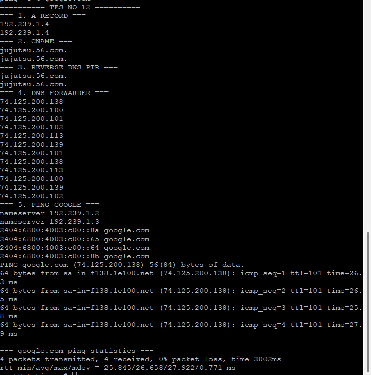

---

### 13. Konfigurasi Replikasi Database MariaDB Master–Slave
---

Pada nomor 13, dilakukan konfigurasi replikasi database menggunakan MariaDB dengan **Yaga sebagai Master** dan **Inumaki sebagai Slave**. Replikasi bertujuan menyinkronkan perubahan data pada Master secara otomatis ke Slave sehingga salinan database tetap tersedia pada server lain.

Database yang digunakan adalah `db_shibuya_56` dengan tabel `request_logs`. Tabel tersebut berfungsi menyimpan catatan request API yang nantinya diproses oleh API worker.

Struktur tabel adalah sebagai berikut.

| Kolom | Tipe Data | Fungsi |
|---|---|---|
| `id` | `BIGINT UNSIGNED` | Identitas request |
| `endpoint` | `VARCHAR(255)` | Endpoint API |
| `method` | `VARCHAR(10)` | Metode HTTP |
| `client_ip` | `VARCHAR(45)` | Alamat IP |
| `created_at` | `TIMESTAMP` | Waktu pencatatan |

MariaDB Master pada Yaga dikonfigurasikan dengan binary logging dan akun replikasi `replica56` untuk menghubungkan Slave ke Master.

Pengujian status Master dilakukan menggunakan:

```bash
mariadb -e "SHOW MASTER STATUS\G"
```

Kemudian pemeriksaan database dilakukan menggunakan:

```bash
mariadb -e "SHOW DATABASES;"
```

Hasil pengujian menunjukkan binary log `no13-bin.000001` telah tersedia, dan database `db_shibuya_56` berhasil dibuat.

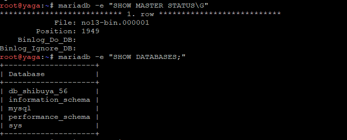

Setelah memastikan database tersedia, dilakukan pengujian penambahan data pada Yaga dengan perintah:

```sql
USE db_shibuya_56;

INSERT INTO request_logs (endpoint, method, client_ip)
VALUES ('/api/tes13', 'GET', '192.239.4.10');

SELECT * FROM request_logs;
```

Hasil menunjukkan satu baris berhasil ditambahkan dengan endpoint `/api/tes13`, method `GET`, serta alamat IP `192.239.4.10`.

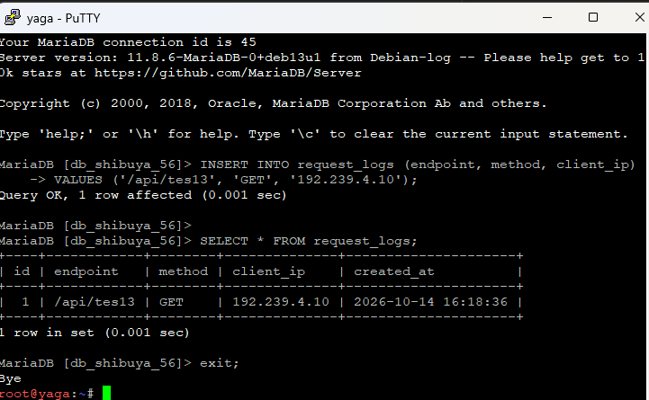

Untuk memastikan replikasi berjalan, dilakukan pemeriksaan tabel pada Inumaki menggunakan:

```bash
mariadb db_shibuya_56
```

Kemudian:

```sql
SELECT * FROM request_logs;
```

Hasil menunjukkan data yang sebelumnya dimasukkan pada Yaga juga muncul pada Inumaki dengan informasi ID, endpoint, method, IP, dan waktu pencatatan yang sama.

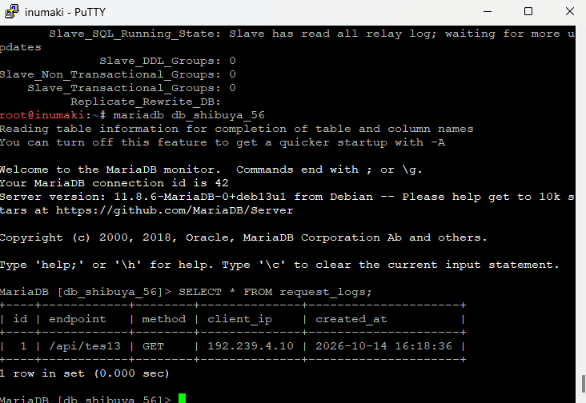

Selanjutnya, dilakukan pemeriksaan akses database dari Nanami sebagai salah satu API worker:

```bash
mariadb -h 192.239.4.9 -u api56 -p db_shibuya_56
```

Setelah terhubung, dilakukan pemeriksaan tabel menggunakan:

```sql
SHOW TABLES;
SELECT * FROM request_logs;
```

Hasil pengujian menunjukkan tabel `request_logs` tersedia dan dapat diakses melalui koneksi database dari Nanami.

.png)

Status replikasi pada Inumaki juga diperiksa menggunakan:

```bash
mariadb -e "SHOW SLAVE STATUS\G"
```

Pada hasil pengujian, ditemukan parameter berikut:

```text
Master_Host: 192.239.4.9
Slave_IO_Running: Yes
Slave_SQL_Running: Yes
Last_Errno: 0
```

Kondisi `Slave_IO_Running: Yes` menunjukkan proses penerimaan binary log dari Master berjalan, sedangkan `Slave_SQL_Running: Yes` menunjukkan proses penerapan perubahan database pada Slave juga aktif.

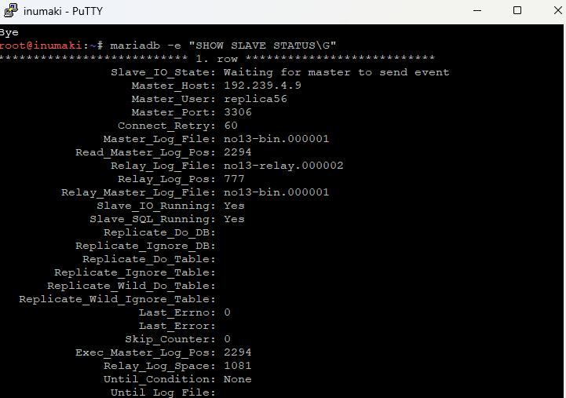

---

### 14. Implementasi Frontend Nginx, PHP-FPM, dan API Worker
---

Pada nomor 14, dilakukan implementasi layanan frontend dan backend menggunakan Nginx serta PHP-FPM. Maki dan Panda berperan sebagai frontend worker yang menampilkan identitas hostname masing-masing, sedangkan Nanami, Todo, dan Kirara berperan sebagai API worker yang mencatat request ke database Yaga.

Pembagian node dan layanan dapat dilihat pada tabel berikut.

| Node | IP Address | Fungsi | Akses yang Diizinkan |
|---|---|---|---|
| Maki | `192.239.4.3` | Frontend | Gojo |
| Panda | `192.239.4.4` | Frontend | Gojo |
| Nanami | `192.239.4.5` | API Worker | Geto |
| Todo | `192.239.4.6` | API Worker | Geto |
| Kirara | `192.239.4.7` | API Worker | Geto |

Frontend dibuat menggunakan PHP untuk menampilkan hostname masing-masing worker. Konfigurasi Nginx dibuat agar frontend hanya dapat diakses melalui jalur proxy Gojo, sedangkan API worker hanya dapat diakses dari Geto.

Pada frontend, pembatasan akses diterapkan menggunakan:

```nginx
allow 192.239.1.4;
deny all;
```

Sedangkan pada API worker:

```nginx
allow 192.239.4.2;
deny all;
```

Layanan API menggunakan PHP dan ekstensi PDO MySQL untuk menghubungkan worker ke database `db_shibuya_56` pada Yaga. Setiap request yang berhasil diproses dicatat ke tabel `request_logs` dengan informasi endpoint, method, dan client IP.

Pengujian frontend dilakukan melalui Gojo:

```bash
lynx -dump http://192.239.4.3/
lynx -dump http://192.239.4.4/
```

Hasil pengujian menunjukkan bahwa Maki menampilkan `Server: maki`, sedangkan Panda menampilkan `Server: panda`. Kedua frontend berhasil menampilkan halaman web melalui Nginx dan PHP-FPM.

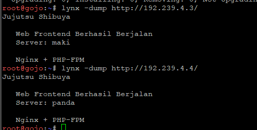

Selanjutnya dilakukan pengujian API melalui Geto menggunakan perintah:

```bash
lynx -dump http://192.239.4.5/api
lynx -dump http://192.239.4.6/api
lynx -dump http://192.239.4.7/api
```

Ketiga worker berhasil menghasilkan respons JSON dengan `status: success`, nama worker sesuai server yang diakses, dan `logged: true`.

Contoh respons:

```json
{
    "status": "success",
    "worker": "nanami",
    "endpoint": "/api",
    "method": "GET",
    "logged": true,
    "request_id": "5"
}
```

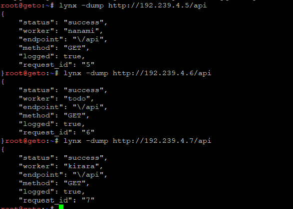

Pengujian berikutnya dilakukan untuk memastikan klien tidak dapat mengakses worker secara langsung. Dari Itadori, dijalankan:

```bash
lynx -dump http://192.239.4.5/api
lynx -dump http://192.239.4.3/
lynx -dump http://192.239.4.4/
```

Hasilnya menunjukkan `403 Forbidden`, yang menandakan bahwa aturan pembatasan akses Nginx berhasil diterapkan. Worker hanya menerima request dari jalur proxy yang telah ditentukan.

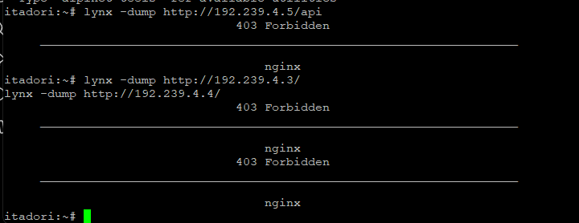

---

### 15. Implementasi Load Balancing API Menggunakan Weighted Round Robin
---

Pada nomor 15, dilakukan konfigurasi Nginx pada Geto sebagai load balancer untuk mendistribusikan request API ke Nanami dan Todo. Metode yang digunakan adalah **Weighted Round Robin**, yaitu mekanisme pembagian request berdasarkan nilai bobot masing-masing worker.

Nanami diberikan bobot `weight=3`, sedangkan Todo diberikan `weight=1`, sehingga target distribusi request adalah sekitar 75% ke Nanami dan 25% ke Todo.

Konfigurasi upstream pada Geto adalah:

```nginx
upstream api_cluster {
    server 192.239.4.5:80 weight=3;
    server 192.239.4.6:80 weight=1;
}
```

Untuk meneruskan request menuju backend, digunakan konfigurasi reverse proxy pada Geto:

```nginx
location = /api {
    proxy_pass http://api_cluster;

    proxy_set_header Host $host;
    proxy_set_header X-Real-IP $remote_addr;
    proxy_set_header X-Forwarded-For $proxy_add_x_forwarded_for;
}
```

Konfigurasi tersebut membuat klien yang mengakses endpoint `/api` pada Geto secara otomatis diteruskan ke salah satu API worker sesuai pembagian bobot.

Pengujian awal dilakukan menggunakan:

```bash
lynx -dump http://192.239.4.2/api
```

Respons menunjukkan API berhasil diproses oleh salah satu worker dengan status `success`.

Untuk membuktikan pembagian beban, dilakukan pengujian sebanyak 40 request menggunakan:

```bash
for i in $(seq 1 40); do
    lynx -dump http://192.239.4.2/api |
    awk -F '"' '/"worker"/ {print $4}'
done | sort | uniq -c
```

Hasil pengujian adalah:

```text
31 nanami
 9 todo
```

Distribusi yang diperoleh dapat dilihat pada tabel berikut.

| Worker | Weight | Target Request | Hasil Aktual | Persentase |
|---|---|---:|---:|---:|
| Nanami | 3 | 30 | 31 | 77,5% |
| Todo | 1 | 10 | 9 | 22,5% |
| **Total** | **4** | **40** | **40** | **100%** |

Hasil tersebut mendekati rasio 3:1 yang telah dikonfigurasikan. Perbedaan kecil dapat terjadi akibat jumlah request terbatas dan kondisi backend pada saat pengujian.

Selanjutnya dilakukan pemeriksaan konfigurasi Nginx menggunakan:

```bash
nginx -t
```

Serta:

```bash
grep -A 5 'upstream api_cluster' /etc/nginx/sites-available/no15
```

Hasil menunjukkan konfigurasi Nginx valid dan upstream menggunakan bobot `weight=3` untuk Nanami serta `weight=1` untuk Todo.

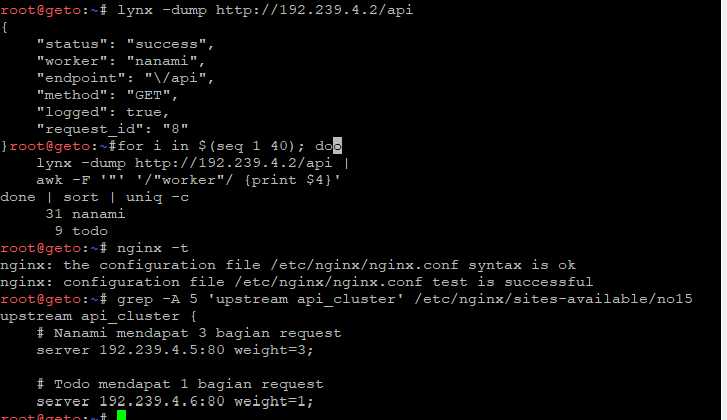

---


### 16. Konfigurasi Reverse Proxy Nginx pada Gojo
---

Pada nomor 16, dilakukan konfigurasi **reverse proxy menggunakan Nginx pada Gojo** sebagai pintu masuk utama layanan web melalui domain `jujutsu.56.com` dan `www.jujutsu.56.com`. Reverse proxy berfungsi menerima request dari klien dan meneruskannya ke server backend sesuai jenis layanan yang diakses.

Pada konfigurasi ini, request menuju halaman utama (`/`) diteruskan secara round robin ke frontend Maki dan Panda. Sementara itu, request menuju endpoint `/api` diteruskan ke Geto sebagai load balancer API yang telah dikonfigurasikan pada nomor 15.

Pembagian layanan reverse proxy adalah sebagai berikut.

| Akses | Server Tujuan | IP Address | Fungsi |
|---|---|---|---|
| `jujutsu.56.com` | Gojo | `192.239.1.4` | Reverse proxy utama |
| `/` | Maki | `192.239.4.3` | Frontend worker |
| `/` | Panda | `192.239.4.4` | Frontend worker |
| `/api` | Geto | `192.239.4.2` | Load balancer API |
| API Worker | Nanami dan Todo | `192.239.4.5–6` | Pemrosesan API |

Konfigurasi upstream frontend pada Gojo menggunakan:

```nginx
upstream frontend_cluster {
    server 192.239.4.3:80;
    server 192.239.4.4:80;
}
```

Kedua server memiliki bobot yang sama sehingga Nginx dapat membagikan request secara round robin.

Konfigurasi reverse proxy diterapkan melalui virtual host:

```nginx
server {
    listen 80 default_server;

    server_name jujutsu.56.com www.jujutsu.56.com;

    location = /api {
        proxy_pass http://192.239.4.2:80;

        proxy_http_version 1.1;

        proxy_set_header Host $host;
        proxy_set_header X-Real-IP $remote_addr;
        proxy_set_header X-Forwarded-For $proxy_add_x_forwarded_for;
        proxy_set_header X-Forwarded-Proto $scheme;
    }

    location ^~ /api/ {
        proxy_pass http://192.239.4.2:80;

        proxy_http_version 1.1;

        proxy_set_header Host $host;
        proxy_set_header X-Real-IP $remote_addr;
        proxy_set_header X-Forwarded-For $proxy_add_x_forwarded_for;
        proxy_set_header X-Forwarded-Proto $scheme;
    }

    location / {
        proxy_pass http://frontend_cluster;

        proxy_http_version 1.1;

        proxy_set_header Host $host;
        proxy_set_header X-Real-IP $remote_addr;
        proxy_set_header X-Forwarded-For $proxy_add_x_forwarded_for;
        proxy_set_header X-Forwarded-Proto $scheme;
    }
}
```

Setelah konfigurasi diaktifkan, dilakukan pengujian DNS dari Itadori menggunakan perintah:

```bash
dig @192.239.1.2 jujutsu.56.com A +short

dig @192.239.1.2 www.jujutsu.56.com +short
```

Hasil pengujian menunjukkan domain utama dan subdomain `www` mengarah ke Gojo dengan alamat `192.239.1.4`.

Pengujian akses frontend dilakukan menggunakan:

```bash
lynx -dump http://jujutsu.56.com/
```

Untuk menguji distribusi request frontend, digunakan:

```bash
for i in $(seq 1 8); do
    lynx -dump http://jujutsu.56.com/ |
    grep 'Server:'
done
```

Hasil pengujian menunjukkan bahwa request berhasil dilayani oleh Maki dan Panda. Dari delapan request yang dilakukan, Maki menerima enam request dan Panda menerima dua request. Kedua worker berhasil memberikan respons frontend sesuai hostname masing-masing.

Selanjutnya dilakukan pengujian subdomain:

```bash
lynx -dump http://www.jujutsu.56.com/
```

Hasil menunjukkan halaman frontend berhasil ditampilkan melalui subdomain `www`.

Untuk menguji reverse proxy API, digunakan:

```bash
lynx -dump http://jujutsu.56.com/api
```

Hasil pengujian menunjukkan respons API berstatus `success` dengan worker `todo` dan `logged: true`. Hal ini membuktikan bahwa request API berhasil diteruskan melalui Gojo menuju Geto dan diproses oleh API worker.

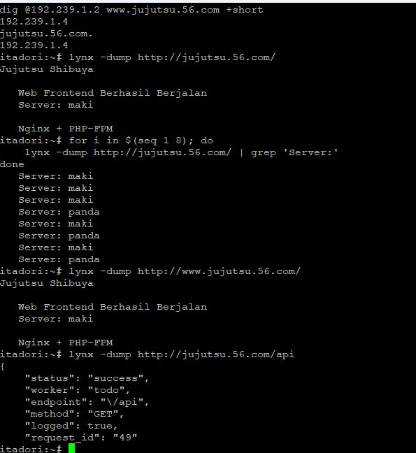

Selanjutnya, dilakukan pemeriksaan database pada Yaga untuk memastikan request API yang dikirim melalui Gojo berhasil dicatat.

Perintah pengujian:

```sql
USE db_shibuya_56;

SELECT id, endpoint, method, client_ip
FROM request_logs
ORDER BY id DESC
LIMIT 10;
```

Hasil pengujian menunjukkan request terbaru dengan endpoint `/api`, method `GET`, dan alamat IP `192.239.4.2`, yaitu IP Geto sebagai proxy terakhir sebelum API worker. Pada tahap nomor 16, pencatatan IP tersebut masih sesuai karena penerusan alamat IP asli klien akan diterapkan pada nomor 17.

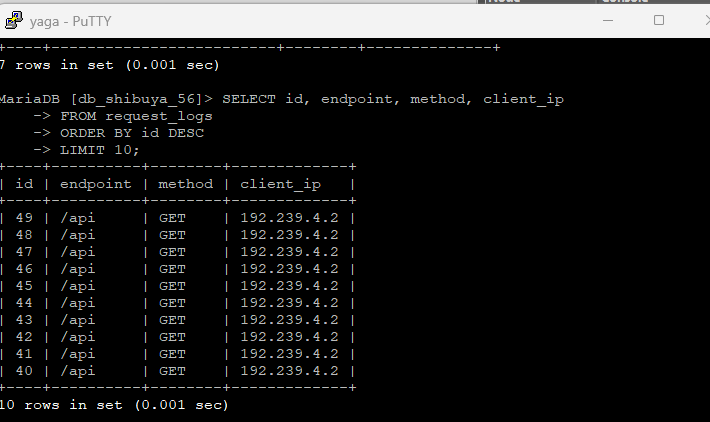

---

### 17. Implementasi Real Client IP pada Reverse Proxy
---

Pada nomor 17, dilakukan implementasi **Real Client IP** agar alamat IP asli klien dapat diteruskan melalui beberapa lapisan reverse proxy dan dicatat pada database Yaga.

Sebelum konfigurasi ini diterapkan, API worker membaca alamat IP dari koneksi langsung menggunakan `REMOTE_ADDR`. Karena request API diteruskan melalui Geto, database mencatat alamat IP Geto (`192.239.4.2`), bukan alamat IP klien sebenarnya.

Untuk mengatasi masalah tersebut, diterapkan forwarding header `X-Real-IP` dan `X-Forwarded-For` pada Gojo dan Geto. Pengaturan trusted proxy digunakan agar informasi IP dari header hanya dipercaya jika berasal dari proxy yang diizinkan.

Konfigurasi forwarding header pada Gojo menggunakan:

```nginx
proxy_set_header Host $host;
proxy_set_header X-Real-IP $remote_addr;
proxy_set_header X-Forwarded-For $proxy_add_x_forwarded_for;
```

Pada Geto, Gojo dikonfigurasikan sebagai trusted proxy menggunakan:

```nginx
set_real_ip_from 192.239.1.4;
real_ip_header X-Real-IP;
```

Konfigurasi tersebut membuat Geto hanya menggunakan informasi `X-Real-IP` dari koneksi yang berasal dari Gojo.

Selanjutnya, API worker dikonfigurasikan untuk membaca alamat IP asli yang diteruskan oleh Geto.

Bagian kode PHP untuk penentuan IP klien adalah:

```php
$peerIp = $_SERVER['REMOTE_ADDR'] ?? '';
$realIp = $_SERVER['HTTP_X_REAL_IP'] ?? '';

$clientIp = (
    $peerIp === '192.239.4.2'
    && filter_var($realIp, FILTER_VALIDATE_IP)
) ? $realIp : $peerIp;
```

Kode tersebut hanya mempercayai informasi `X-Real-IP` ketika request berasal dari Geto (`192.239.4.2`). Nilai IP yang diperoleh kemudian disimpan pada kolom `client_ip` dalam tabel `request_logs`.

Pengujian pertama dilakukan menggunakan klien **Itadori** yang berada pada Network 2.

Alamat IP Itadori diperiksa menggunakan:

```bash
ip -4 -br addr show eth0
```

Hasilnya menunjukkan:

```text
eth0 UNKNOWN 192.239.2.10/24
```

Kemudian dilakukan request API:

```bash
lynx -dump http://jujutsu.56.com/api
```

Hasil menunjukkan API berhasil diproses oleh Nanami dengan `status: success`, `logged: true`, dan `request_id: 50`.

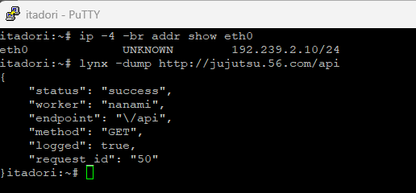

Selanjutnya dilakukan pemeriksaan database Yaga menggunakan:

```sql
SELECT id, endpoint, method, client_ip
FROM request_logs
ORDER BY id DESC
LIMIT 5;
```

Hasil menunjukkan request dengan ID 50 telah mencatat alamat IP `192.239.2.10`, sesuai dengan IP asli Itadori. Hal ini berbeda dengan request sebelumnya yang masih mencatat IP Geto `192.239.4.2`.

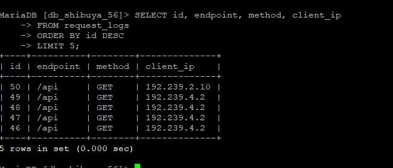

Pengujian berikutnya dilakukan dari **Miwa** sebagai klien Network 3, untuk membuktikan bahwa pencatatan Real Client IP tidak hanya bekerja pada satu segmen jaringan.

Pemeriksaan IP Miwa:

```bash
ip -4 -br addr show eth0
```

Hasil:

```text
eth0 UNKNOWN 192.239.3.100/24
```

Kemudian dilakukan akses API:

```bash
lynx -dump http://jujutsu.56.com/api
```

Respons API menunjukkan `status: success`, `worker: nanami`, `logged: true`, dan `request_id: 51`.

Pada database Yaga, request ID 51 tercatat dengan IP `192.239.3.100`. Dengan demikian, dua klien dari subnet berbeda berhasil dicatat menggunakan alamat IP aslinya masing-masing.

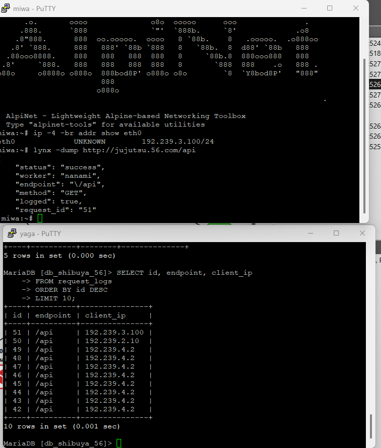

Hasil pencatatan IP klien adalah sebagai berikut.

| Request ID | Klien | IP Address | Keterangan |
|---|---|---|---|
| 49 | Request sebelum nomor 17 | `192.239.4.2` | IP Geto |
| 50 | Itadori | `192.239.2.10` | IP asli klien |
| 51 | Miwa | `192.239.3.100` | IP asli klien |

Sebagai pengujian tambahan, dilakukan akses langsung dari Itadori menuju API worker Nanami:

```bash
lynx -dump http://192.239.4.5/api
```

Hasil pengujian menunjukkan `403 Forbidden`, yang membuktikan bahwa pembatasan akses langsung pada nomor 14 tetap berfungsi setelah konfigurasi Real Client IP diterapkan.

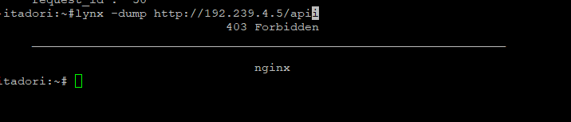

---

### 18. Implementasi Failover API Menggunakan Backup Worker
---

Pada nomor 18, dilakukan konfigurasi **failover API** pada load balancer Geto untuk menjaga ketersediaan layanan ketika API worker utama mengalami gangguan.

Dalam konfigurasi ini, Nanami dan Todo digunakan sebagai primary worker, sedangkan Kirara dikonfigurasikan sebagai backup worker. Kirara hanya digunakan ketika seluruh primary worker dinyatakan tidak tersedia oleh Nginx.

Pengaturan worker adalah sebagai berikut.

| Worker | IP Address | Peran | Konfigurasi |
|---|---|---|---|
| Nanami | `192.239.4.5` | Primary | `weight=3` |
| Todo | `192.239.4.6` | Primary | `weight=1` |
| Kirara | `192.239.4.7` | Backup | `backup` |

Konfigurasi upstream pada Geto menggunakan:

```nginx
upstream api_cluster {
    server 192.239.4.5:80 weight=3 max_fails=2 fail_timeout=5s;
    server 192.239.4.6:80 weight=1 max_fails=2 fail_timeout=5s;
    server 192.239.4.7:80 backup;
}
```

Parameter `max_fails=2` menentukan ambang kegagalan worker dalam interval yang ditentukan oleh `fail_timeout=5s`. Sementara itu, parameter `backup` membuat Kirara hanya menerima request ketika primary worker tidak tersedia.

Untuk mendukung proses failover, Geto juga menggunakan konfigurasi:

```nginx
proxy_next_upstream error timeout http_502 http_503 http_504;
proxy_next_upstream_tries 3;
proxy_connect_timeout 2s;
proxy_read_timeout 5s;
```

Konfigurasi tersebut memungkinkan Nginx mencoba upstream lain apabila terjadi kegagalan koneksi, timeout, atau respons kesalahan upstream yang dikonfigurasikan untuk retry.

Pengujian dilakukan dengan mensimulasikan kegagalan API worker secara bertahap.

#### Pengujian 1 — Seluruh Primary Worker Aktif

Pada kondisi awal, Nanami dan Todo dibiarkan aktif. Pengujian dilakukan melalui Itadori menggunakan:

```bash
lynx -dump http://jujutsu.56.com/api
```

Hasil menunjukkan respons API berstatus `success` yang diproses oleh Nanami.

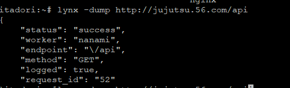

Selanjutnya, pengujian distribusi delapan request dilakukan pada Geto menggunakan:

```bash
for i in $(seq 1 8); do
    lynx -dump http://192.239.4.2/api |
    awk -F '"' '/"worker"/ {print $4}'
done | sort | uniq -c
```

Hasil menunjukkan:

```text
7 nanami
1 todo
```

Kedua primary worker masih menerima request, sedangkan Kirara belum digunakan.

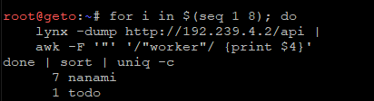

#### Pengujian 2 — Nanami Mengalami Gangguan

Untuk mensimulasikan kegagalan primary worker pertama, layanan Nginx pada Nanami dihentikan menggunakan:

```bash
nginx -s stop
```

Perintah tersebut menghentikan web server Nanami sehingga worker tidak lagi dapat menerima request HTTP.

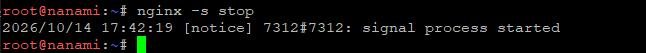

Selanjutnya dilakukan pengujian delapan request kembali dari Geto:

```bash
for i in $(seq 1 8); do
    lynx -dump http://192.239.4.2/api |
    awk -F '"' '/"worker"/ {print $4}'
done | sort | uniq -c
```

Hasil menunjukkan:

```text
8 todo
```

Seluruh request berhasil dialihkan ke Todo setelah Nanami tidak tersedia. Kirara belum digunakan karena masih terdapat satu primary worker yang aktif.

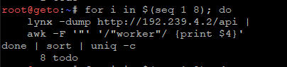

#### Pengujian 3 — Nanami dan Todo Mengalami Gangguan

Setelah Nanami dihentikan, pengujian dilanjutkan dengan menghentikan Nginx pada Todo menggunakan:

```bash
nginx -s stop
```

Dengan kondisi tersebut, kedua primary worker dinyatakan tidak tersedia untuk menerima request.

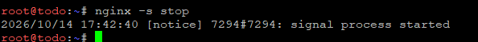

Pengujian kembali dilakukan dari Geto menggunakan:

```bash
for i in $(seq 1 8); do
    lynx -dump http://192.239.4.2/api |
    awk -F '"' '/"worker"/ {print $4}'
done | sort | uniq -c
```

Hasil pengujian menunjukkan:

```text
8 kirara
```

Artinya seluruh request berhasil dialihkan ke Kirara sebagai backup worker.

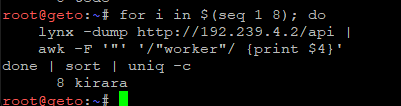

Untuk memastikan failover juga berjalan melalui domain utama, dilakukan pengujian dari Itadori menggunakan:

```bash
lynx -dump http://jujutsu.56.com/api
```

Hasil menunjukkan respons:

```json
{
    "status": "success",
    "worker": "kirara",
    "endpoint": "/api",
    "method": "GET",
    "logged": true,
    "request_id": "77"
}
```

Respons tersebut membuktikan bahwa layanan API tetap tersedia melalui domain utama meskipun Nanami dan Todo sedang dihentikan.

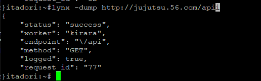

#### Pengujian 4 — Verifikasi Database dan Real Client IP

Setelah failover berlangsung, dilakukan pemeriksaan database pada Yaga menggunakan:

```sql
SELECT id, endpoint, method, client_ip
FROM request_logs
ORDER BY id DESC
LIMIT 5;
```

Hasil menunjukkan bahwa request API selama pengujian tetap dapat dicatat pada database, termasuk request ID 77 dan 78 dengan alamat IP asli Itadori `192.239.2.10`.

Hal ini menunjukkan bahwa mekanisme Real Client IP pada nomor 17 tetap berfungsi ketika API diproses oleh backup worker Kirara.

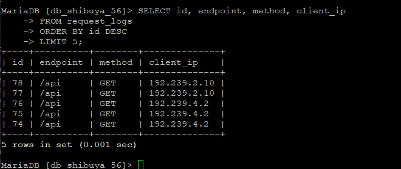

Setelah pengujian selesai, layanan Nginx pada Nanami dan Todo diaktifkan kembali menggunakan:

```bash
nginx
```

Setelah masa kegagalan berlalu, request kembali dapat diproses oleh primary worker sesuai konfigurasi load balancing.

---

### 19. Implementasi Proxy Cache dan Rate Limiting
---

Pada nomor 19, dilakukan implementasi **Proxy Cache dan Rate Limiting pada reverse proxy Gojo**. Kedua mekanisme ini bertujuan meningkatkan efisiensi layanan frontend dan mengendalikan jumlah request API yang diterima server.

Proxy Cache memungkinkan Gojo menyimpan respons frontend untuk digunakan kembali pada request berikutnya, sedangkan Rate Limiting membatasi request ke endpoint `/api` berdasarkan alamat IP klien.

Konfigurasi yang diterapkan adalah:

| Fitur | Pengaturan | Tujuan |
|---|---|---|
| Proxy Cache | 10 menit | Mengurangi request berulang ke frontend |
| Cache Status | `X-Cache-Status` | Menampilkan MISS atau HIT |
| Rate Limiting | 10 request/detik/IP | Membatasi request API |
| Burst | 5 request | Toleransi lonjakan singkat |
| Status Penolakan | HTTP 429 | Menolak request berlebihan |

#### Konfigurasi Proxy Cache

Konfigurasi cache dilakukan pada Nginx Gojo menggunakan:

```nginx
proxy_cache_path /var/cache/nginx/no19
    levels=1:2
    keys_zone=no19_frontend:10m
    max_size=100m
    inactive=10m
    use_temp_path=off;
```

Kemudian pada lokasi frontend digunakan:

```nginx
location / {
    proxy_pass http://frontend_cluster;

    proxy_cache no19_frontend;
    proxy_cache_valid 200 10m;

    proxy_cache_key "$scheme$host$request_uri";

    add_header X-Cache-Status $upstream_cache_status always;
}
```

Konfigurasi tersebut membuat respons HTTP 200 dari frontend dapat disimpan selama 10 menit sesuai aturan validitas cache.

Ketika halaman belum tersedia dalam cache, Nginx mengambil respons dari Maki atau Panda dan menampilkan status `MISS`. Pada request berikutnya dengan cache key yang sama, Nginx dapat menggunakan respons yang tersimpan dan menampilkan status `HIT`.

Pengujian dilakukan dari Itadori menggunakan:

```bash
for i in 1 2 3 4; do
    echo "Request $i"

    wget -S -O /dev/null \
    "http://jujutsu.56.com/?tes=cache19baru2" \
    2>&1 | grep -i 'X-Cache-Status'
done
```

Hasil pengujian yang diperoleh:

```text
Request 1
X-Cache-Status: MISS

Request 2
X-Cache-Status: HIT

Request 3
X-Cache-Status: HIT

Request 4
X-Cache-Status: HIT
```

Pada pengujian diperoleh status `MISS` ketika halaman belum tersedia dalam cache dan `HIT` pada akses berikutnya. Hasil tersebut menunjukkan mekanisme penyimpanan dan penggunaan ulang respons frontend berjalan.

#### Konfigurasi Rate Limiting

Rate Limiting diterapkan untuk membatasi request ke endpoint `/api` sebesar 10 request per detik untuk setiap alamat IP klien.

Konfigurasi zona Rate Limiting pada Nginx menggunakan:

```nginx
limit_req_zone $binary_remote_addr
    zone=no19_api:10m
    rate=10r/s;
```

Sedangkan pada lokasi API diterapkan:

```nginx
limit_req zone=no19_api burst=5 nodelay;
limit_req_status 429;
```

Konfigurasi ini memungkinkan Gojo melakukan pembatasan berdasarkan alamat IP. Request yang melebihi batas dan toleransi burst akan ditolak menggunakan respons `429 Too Many Requests`.

Pengujian pertama dilakukan untuk memastikan API tetap berjalan pada kondisi normal:

```bash
lynx -dump http://jujutsu.56.com/api
```

Hasil menunjukkan:

```json
{
    "status": "success",
    "worker": "todo",
    "endpoint": "/api",
    "method": "GET",
    "logged": true,
    "request_id": "79"
}
```

Selanjutnya dilakukan pengujian 100 request paralel dari Itadori menggunakan:

```bash
seq 1 100 | xargs -P 30 -I '{}' sh -c \
'wget -S -O /dev/null http://jujutsu.56.com/api 2>&1 | grep -E "HTTP/1\.[01] (200|429)"' \
| sort | uniq -c
```

Hasil pengujian menunjukkan:

```text
7   HTTP/1.1 200 OK
93  HTTP/1.1 429 Too Many Requests
```

Berdasarkan hasil tersebut, hanya tujuh request memperoleh respons HTTP 200, sedangkan 93 request lainnya ditolak dengan HTTP 429 akibat pembatasan trafik API.

Persentase hasil pengujian:

| Respons | Jumlah | Persentase |
|---|---:|---:|
| HTTP 200 OK | 7 | 7% |
| HTTP 429 Too Many Requests | 93 | 93% |
| **Total** | **100** | **100%** |

Hasil tersebut menunjukkan Rate Limiting telah aktif dan mampu menolak lonjakan request yang melebihi batas konfigurasi.

Pemeriksaan konfigurasi Nginx dilakukan pada Gojo menggunakan:

```bash
nginx -t
```

Serta:

```bash
nginx -T 2>&1 | grep -E \
'proxy_cache|X-Cache-Status|limit_req|no19_api'
```

Hasil pemeriksaan menunjukkan konfigurasi cache dan Rate Limiting telah dimuat serta sintaks Nginx dinyatakan valid.

---

### 20. Pengujian Performa Menggunakan ApacheBench
---

Pada nomor 20, dilakukan pengujian performa layanan web menggunakan **ApacheBench (`ab`)** dari node Kusakabe. Pengujian bertujuan mengukur kemampuan frontend dan API dalam menangani sejumlah request secara bersamaan setelah konfigurasi reverse proxy, load balancing, proxy cache, dan Rate Limiting diterapkan.

Pengujian dilakukan terhadap domain `jujutsu.56.com` dengan parameter **600 request dan concurrency 30**.

Parameter pengujian adalah sebagai berikut.

| Parameter | Nilai | Keterangan |
|---|---|---|
| Jumlah Request | 600 | Total request yang dikirim |
| Concurrency | 30 | Maksimal request bersamaan |
| Frontend | `http://jujutsu.56.com/` | Pengujian halaman utama |
| API | `http://jujutsu.56.com/api` | Pengujian API melalui Geto |
| Tool | ApacheBench | Pengujian beban HTTP |
| Node Penguji | Kusakabe | Klien benchmark |

ApacheBench digunakan karena mampu mengukur beberapa parameter performa, seperti throughput, waktu respons, jumlah request yang selesai, dan kegagalan selama pengujian.

#### Pengujian 1 — Benchmark Frontend

Pengujian frontend dilakukan dari terminal Kusakabe menggunakan:

```bash
ab -n 600 -c 30 http://jujutsu.56.com/
```

Hasil pengujian dapat disimpan dan diperiksa melalui:

```bash
cat /root/no20-results/frontend.txt
```

Atau untuk menampilkan ringkasan:

```bash
grep -E 'Complete requests:|Failed requests:|Requests per second:|Time per request:|Non-2xx responses:' /root/no20-results/frontend.txt
```

Hasil benchmark frontend menunjukkan:

| Parameter | Hasil |
|---|---:|
| Complete Requests | 600 |
| Failed Requests | 0 |
| Requests per Second | 5.326,80 req/s |
| Time per Request | 5,632 ms |
| Time Taken for Tests | 0,113 detik |
| Document Length | 1.166 bytes |
| Maximum Response Time | 8 ms |

Sebanyak 600 request berhasil diselesaikan tanpa kegagalan yang terdeteksi ApacheBench. Throughput mencapai 5.326,80 request per detik dengan rata-rata waktu per request sebesar 5,632 ms pada concurrency 30.

Nilai tersebut menunjukkan bahwa frontend mampu melayani seluruh beban pengujian dengan respons yang cepat dalam kondisi proxy cache aktif.

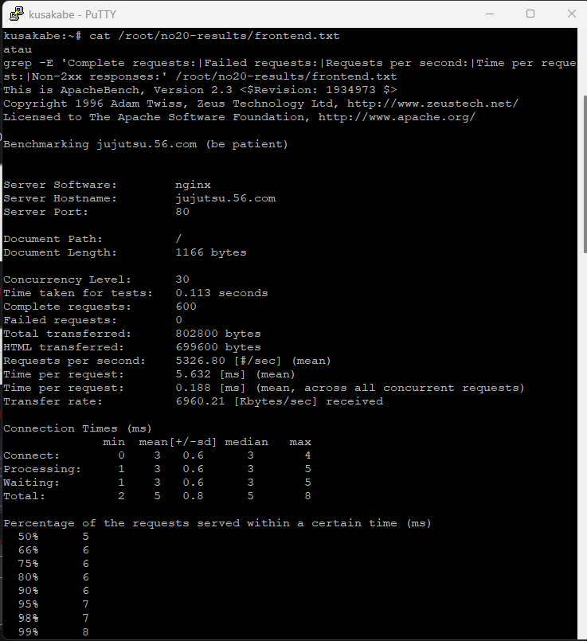

#### Pengujian 2 — Benchmark API

Pengujian selanjutnya dilakukan terhadap endpoint `/api` menggunakan:

```bash
ab -n 600 -c 30 http://jujutsu.56.com/api
```

Hasil benchmark diperiksa melalui:

```bash
cat /root/no20-results/api.txt
```

Untuk melihat informasi kegagalan request secara lebih rinci, digunakan:

```bash
grep -A 8 'Failed requests:' /root/no20-results/api.txt
```

Hasil pengujian API menunjukkan:

| Parameter | Hasil |
|---|---:|
| Complete Requests | 600 |
| Failed Requests | 594 |
| Non-2xx Responses | 593 |
| Requests per Second | 4.389,82 req/s |
| Time per Request | 6,834 ms |
| Time Taken for Tests | 0,137 detik |
| Document Length | 142 bytes |
| Maximum Response Time | 26 ms |

Dari total 600 request yang diselesaikan, sebanyak 593 respons termasuk kategori non-2xx. Hasil ini konsisten dengan adanya pembatasan trafik API melalui Rate Limiting pada Gojo.

ApacheBench juga mencatat sebanyak 594 failed requests dengan rincian:

```text
Failed requests: 594
(Connect: 0, Receive: 0, Length: 594, Exceptions: 0)

Non-2xx responses: 593
```

Nilai `Connect: 0` menunjukkan tidak terdapat kegagalan koneksi yang terdeteksi, sedangkan `Receive: 0` menunjukkan tidak terdapat kegagalan penerimaan respons.

Sebanyak 594 kegagalan diklasifikasikan sebagai `Length`, yaitu perbedaan panjang respons dibandingkan panjang respons acuan ApacheBench. Hal ini dapat dipengaruhi oleh perbedaan konten respons API normal dan halaman penolakan HTTP 429, maupun perubahan panjang JSON.

Dengan demikian, nilai `Failed requests` tidak dapat langsung diartikan sebagai jumlah kegagalan koneksi jaringan.

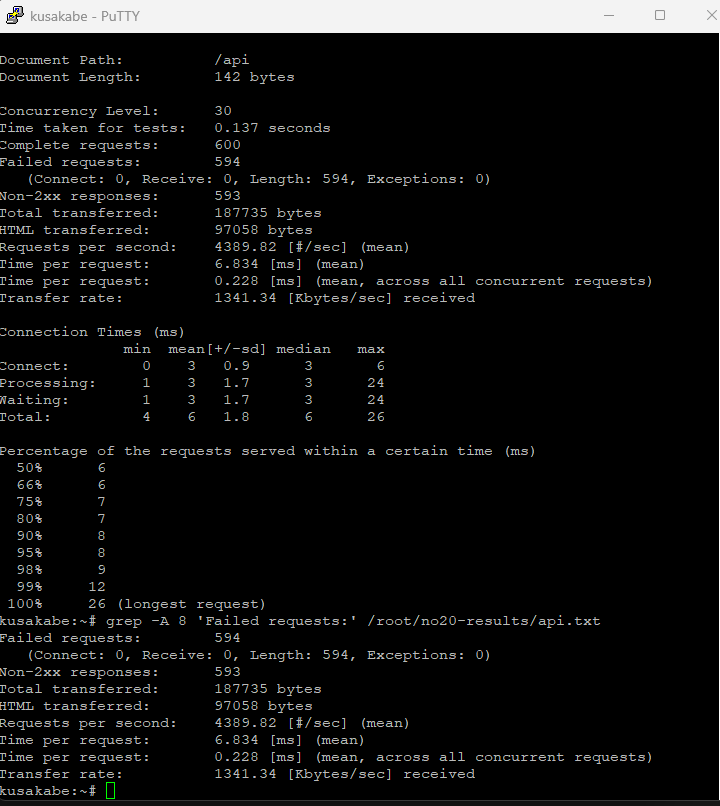

#### Perbandingan Performa Frontend dan API

Ringkasan hasil kedua pengujian adalah sebagai berikut.

| Parameter | Frontend | API |
|---|---:|---:|
| Complete Requests | 600 | 600 |
| Concurrency | 30 | 30 |
| Failed Requests | 0 | 594 |
| Non-2xx Responses | 0 | 593 |
| Throughput | 5.326,80 req/s | 4.389,82 req/s |
| Time per Request | 5,632 ms | 6,834 ms |
| Total Waktu | 0,113 detik | 0,137 detik |

Berdasarkan hasil tersebut, throughput frontend lebih tinggi dibandingkan API. Frontend juga menunjukkan waktu respons rata-rata yang lebih rendah.

Perbedaan ini berkaitan dengan karakteristik layanan yang diuji. Frontend dapat menggunakan respons yang tersimpan pada proxy cache, sedangkan API memerlukan pemrosesan backend dan pencatatan request ke database untuk request yang diizinkan.

Selain itu, pembatasan request pada endpoint `/api` menyebabkan banyak respons non-2xx. Oleh karena itu, throughput ApacheBench pada pengujian API mencakup respons HTTP yang berhasil diselesaikan oleh server, termasuk respons penolakan, dan tidak dapat diartikan sebagai jumlah transaksi API sukses per detik.

Untuk mengonfirmasi mekanisme Rate Limiting, dilakukan pemeriksaan log Nginx pada Gojo menggunakan:

```bash
grep 'limiting requests' /var/log/nginx/error.log | tail -10
```

Hasil log menunjukkan request dari IP Kusakabe (`192.239.2.11`) dibatasi melalui zona `no19_api`, sehingga mendukung hasil benchmark API yang menghasilkan banyak respons non-2xx.

